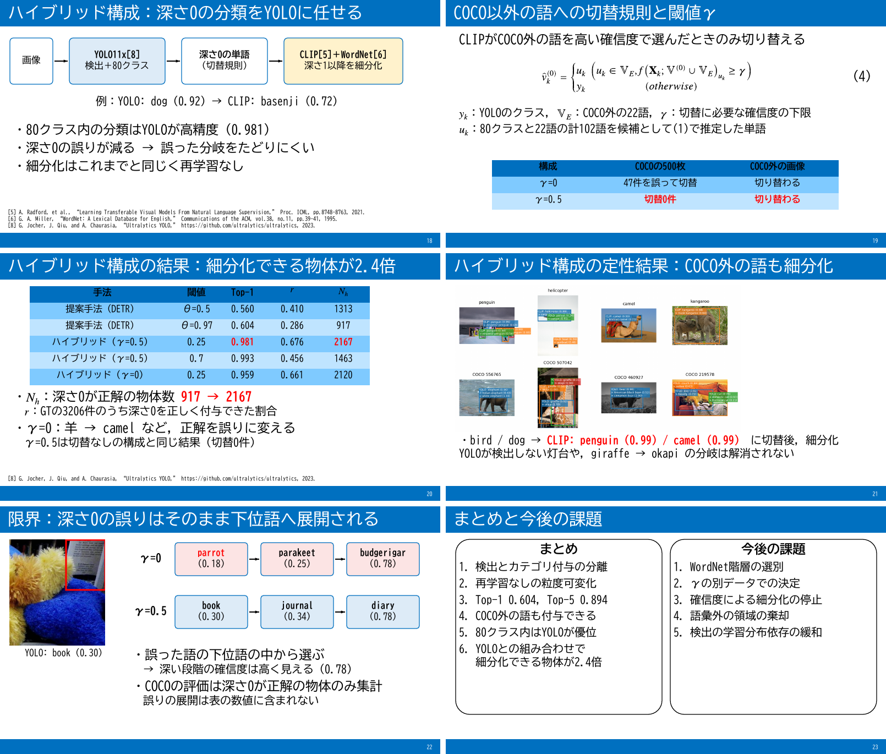

# report_007：ハイブリッド構成の発表スライドへの追加

## 1. 概要

order_006で実装・論文に追記したハイブリッド構成（ex006，論文4.9節）を，発表スライド `slides_object_annotation.pptx` に追加した．
既存の17枚（タイトル〜YOLOとの比較②）は変更せず，18〜22枚目に5枚を追加し，まとめのスライドを23枚目として更新した．
スライドは `slides/build_slides.py` で全体を再生成し，`.ai/pptx-render` でPDF `slides_object_annotation.pdf` を再作成した．

| 項目 | 内容 |
| :--- | :--- |
| 枚数 | 18枚 → 23枚 |
| 生成方法 | `slides/build_slides.py`（テンプレート `research.pptx` を展開してOOXMLを直接書き込む．LibreOfficeは不使用） |
| 数値・図の出典 | `outputs/ex006_coco_val500_yolo_clip_hybrid/table_hybrid.csv`，同 `hybrid_switch*/coco_qualitative_conf0.25/42/annotations.json`，`paper/figures/fig_hybrid_qualitative.png` |
| 検証 | pptxスキルの `validate.py --original`（テンプレート基準）で全項目合格．`pptx-render` のPDFで追加・変更した6枚を目視確認 |

## 2. 追加・変更したスライド

| No. | タイトル | 主な内容 |
| :---: | :--- | :--- |
| 18 | ハイブリッド構成：深さ0の分類をYOLOに任せる | 画像 → YOLO11x → 深さ0（切替規則）→ CLIP＋WordNet の流れ図．例：YOLO: dog（0.92）→ basenji（0.72） |
| 19 | COCO以外の語への切替規則と閾値γ | 論文の式(9)に対応する式(4)と変数の説明．γ=0は500枚で47件を誤って切替，γ=0.5は切替0件かつCOCO外の画像では切り替わる |
| 20 | ハイブリッド構成の結果：細分化できる物体が2.4倍 | 論文の表6を抜粋（提案手法θ=0.5/0.97，ハイブリッドγ=0.5の閾値0.25/0.7，γ=0の閾値0.25）．$`N_h`$：917 → 2167 |
| 21 | ハイブリッド構成の定性結果：COCO外の語も細分化 | 論文の図10．bird / dog → penguin（0.99）/ camel（0.99）．灯台とgiraffe → okapiは解消されない |
| 22 | 限界：深さ0の誤りはそのまま下位語へ展開される | COCO 262938の本の領域（YOLO: book，検出スコア0.30）．γ=0：parrot（0.18）→ parakeet（0.25）→ budgerigar（0.78），γ=0.5：book（0.30）→ journal（0.34）→ diary（0.78）．COCOの定量評価は深さ0が正解の物体のみ集計していることを明記 |
| 23 | まとめと今後の課題（更新） | まとめに「6. YOLOとの組み合わせで細分化できる物体が2.4倍」を追加．課題の「YOLOとVLMの組み合わせ」を，「γの別データでの決定」と「確信度による細分化の停止」に置き換えた |

22枚目の数値は `hybrid_switch` と `hybrid_switch_c0.5` の `annotations.json` から直接取得した．
同じ本の領域でも，γ=0では深さ0がparrotに切り替わり，深さ2のbudgerigarの確信度は0.78と高い．
すなわち，深い段階の確信度だけを見ても深さ0の誤りは検出できない．
スライド用の切り出し画像 `slides/media/hybrid_book.png` は `make_book_crop()` で作成した．

## 3. 規約への対応と生成スクリプトの変更点

- 文字サイズは本文28pt，注釈24pt，図表20ptとし，箇条書きは「・」，番号は「1.」の文字で記述した．
- 式(4)はpandocでLaTeXからOMMLへ変換したネイティブ数式である．式中の変数（$`y_k`$，$`u_k`$，$`{\mathbb V}_E`$，$`\gamma`$）を式の下で説明した．
- 表のセルに `$...$` で囲んだ文字列を与えると数式として挿入するよう `Slide.table()` を拡張し，20枚目の見出しの $`r`$ と $`N_h`$ をネイティブ数式とした．見出し行の数式には白色を指定した．
- 数式中の日本語を含むランに東アジア文字のフォント（BIZ UDGothic）を指定する処理を `latex_to_omml()` に追加した．ただし，`pptx-render` は数式中の日本語を描画しなかったため，式(4)の条件は「,」と「otherwise」で記述した（論文では「かつ」「それ以外」）．
- 初回のレンダリングで，式(4)の日本語の欠落と，注釈中の $`r`$ が通常の文字であることを確認し，修正した．

## 4. 未解決の論点と次に検討すべき作業の候補

1. **発表時間**：23枚となり，約15分の想定（report_004）を超える可能性がある．時間が足りない場合，18枚目と19枚目の統合や，11枚目（実験2）の削除で調整できる．
2. **PowerPointでの表示確認**：`pptx-render` では，式(4)の「otherwise」が斜体で描画され，20枚目の見出し行の数式が白色にならなかった．OMML上は立体（`m:sty p`）および白色を指定しているため，PowerPointで開いて確認する必要がある．
3. **γ=0.5の位置付け**：γ=0.5はγ=0の結果を見た後に追加した設定であり，別データでの検証は行っていない．19枚目と23枚目の課題に記載したが，質疑で指摘される可能性がある．
4. **16枚目の閾値の列**：YOLOとの比較①の表には閾値の列がなく，提案手法のθ=0.97のみ明記している．20枚目の表と形式が揃っていない．
5. **発表者ノート**：作成していない．
6. **ai-agentによる検証**：`tokens.json` が存在しないため，slideエージェントによるスタイルの検証は実行していない．
