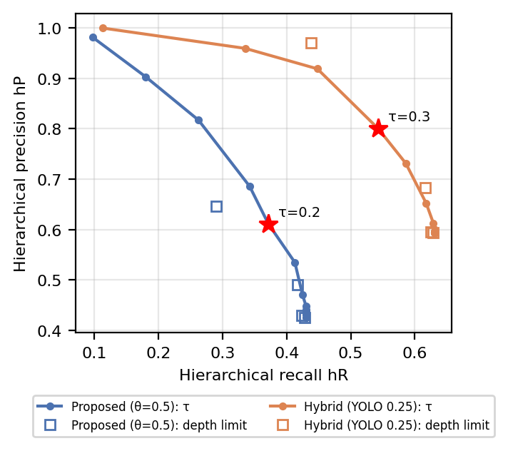

# report_008：粒度可変アノテーションの評価の改善（ex007）

## 1. 概要

order_008では，直前に提案した改善策を次の順に実施した．

1. **A1・A5：** 評価数 $`n`$ を揃えた比較と，深さ0の誤りの伝播の評価
2. **B1・A3：** 累積確信度による細分化の停止規則と，検証用・テスト用のデータ分割
3. **A4：** LVIS v1 を用いた深さ1以降の正誤の評価

新しい実験 `programs/ex007_coco_val_hierarchy_eval/` を作成した．
結果は論文（4.9節の訂正，4.10節・4.11節の追加）とスライド（19・20・26枚目の訂正，23〜25枚目の追加）に反映した．

また，作業中に **ex006の不具合** を発見し，修正した．
`hybrid_switch_c0.5`（$`\gamma = 0.5`$）でCLIPのスコアが計算されておらず，切替の判定が一度も行われていなかった．
そのため，order_006で報告した「$`\gamma = 0.5`$ では500枚のいずれの閾値でも切替は0件」は誤りである．
正しくは，閾値0.25で2件，0.5で2件，0.7で1件の誤った切替が生じる．
定性結果の図（論文の図10）は別の関数で計算しており，この不具合の影響を受けていない．

| 項目 | 内容 |
| :--- | :--- |
| データ | COCO 2017 val の5000枚．LVIS v1 val のアノテーションがある画像は4809枚 |
| 分割（seed 42） | dev500：これまでの500枚．test500：残り4500枚を2等分した後半から500枚（GT 3748件）．lvis_dev：dev500と前半（2604枚）．lvis_test：後半（2148枚） |
| 手法 | 提案手法（DETR，$`\theta \in \{0.5, 0.7, 0.9, 0.97\}`$），ハイブリッド構成（YOLO11x，閾値 $`\in \{0.25, 0.5, 0.7\}`$），切替あり（$`\gamma = 0`$，$`\gamma = 0.5`$） |
| 展開 | 深さ0の正誤によらず，全インスタンスについて下位語の集合が空になるまで展開する |
| 停止規則 | 累積確信度 $`c^{(d)} = \prod_{j \le d} p_j`$ が $`\tau`$ 以上の最も深い段階まで出力する．$`c^{(0)} < \tau`$ なら棄却する．比較として深さの上限（0〜3）で止める規則も評価した |
| τの決定 | lvis_dev で階層的F値 $`hF`$ が最大となる値を13通りから選ぶ |
| 実行 | 検出（DETR，YOLO11x）は5000枚に対して1回ずつ実行した．全条件の合計は約15分，ピークVRAMは1.05 GiB |
| 確認 | dev500 の $`n`$，Top-1 正解率，$`N_h`$ は ex003・ex005・ex006 の値と一致した．テストは17件すべて合格 |

## 2. 結果

### 2.1 A1：評価数を揃えた比較（`table_conditions.csv`，`table_pairs_agreement.csv`）

| 分割 | 提案手法 | $`n`$ | $`N_h`$ | ハイブリッド | $`n`$ | $`N_h`$ | 倍率 | 深さ1の一致率 |
| :--- | :---: | :---: | :---: | :---: | :---: | :---: | :---: | :---: |
| dev500 | θ=0.5 | 2343 | 1313 | 0.25 | 2210 | 2167 | 1.65 | 0.751 |
| dev500 | θ=0.97 | 1519 | 917 | 0.7 | 1474 | 1463 | 1.60 | 0.796 |
| test500 | θ=0.5 | 2736 | 1509 | 0.25 | 2572 | 2492 | 1.65 | 0.704 |
| test500 | θ=0.97 | 1669 | 1043 | 0.7 | 1584 | 1556 | 1.49 | 0.750 |

- **「2.4倍」の訂正：** これまでスライドに書いていた「2.4倍」は，$`n`$ が揃っていない組（917件と2167件）の比較であった．$`n`$ を揃えると1.49〜1.65倍である．
- **深さ1の一致率：** test500では0.70〜0.75である．検出器が違うだけで，約3割の物体で細分化の結果が変わる．

### 2.2 A5：深さ0の誤りの伝播（test500）

| 指標 | 提案手法（θ=0.5） | ハイブリッド（0.25） |
| :--- | :---: | :---: |
| 誤った枝に展開した割合 | 0.448（1227件） | 0.031（80件） |
| 最深段の確信度の平均（正しい枝 / 誤った枝） | 0.599 / 0.473 | 0.547 / 0.637 |
| AUROC：最深段の確信度 | 0.611 | 0.418 |
| AUROC：累積確信度 | 0.508 | 0.430 |
| AUROC：深さ0の確信度 | 0.725 | 0.715 |

- **深い段階の確信度は誤りの手がかりにならない：** 誤った枝では，誤った語の下位語の中から選ぶため，最深段の確信度で正しい枝と区別できない（AUROC はおおむね0.5以下）．ハイブリッド構成では，誤った枝の方がむしろ確信度が高かった．
- **手がかりは深さ0の確信度のみ：** AUROC は約0.72であった．

### 2.3 γの検証（test500，閾値0.25）

| 構成 | 切替数 | 深さ0のTop-1正解率 | GTカテゴリの下位語でない切替 |
| :--- | :---: | :---: | :---: |
| 切替なし | 0 | 0.969 | 0 |
| γ=0 | 50 | 0.950 | 41 |
| γ=0.5 | 8 | 0.966 | 2（bear → panda，teddy bear → rabbit） |

- **8件の内訳：** $`\gamma = 0.5`$ の8件のうち6件は，bird → flamingo（4件），parrot，penguin であった．いずれもWordNetでGTカテゴリの下位語であり，COCOの評価では誤りになるが，意味としては細かい正しい語である．
- **dev500 の2件：** sheep → camel（0.629）と bird → eagle（0.546）であった．

### 2.4 A4・B1：LVISによる深さ1以降の評価と停止規則（`table_stopping.csv`）

| 手法 | 停止規則 | 被覆率 | Top-1 | $`hP`$ | $`hR`$ | $`hF`$ | LVISの語まで到達 |
| :--- | :--- | :---: | :---: | :---: | :---: | :---: | :---: |
| 提案手法（θ=0.5，489件） | なし | 1.000 | 0.646 | 0.425 | 0.430 | 0.428 | 0.272 |
| 提案手法（θ=0.5，489件） | 深さ1まで | 1.000 | 0.646 | 0.490 | 0.417 | 0.451 | 0.256 |
| 提案手法（θ=0.5，489件） | τ=0.2 | 0.775 | 0.792 | 0.611 | 0.372 | 0.462 | 0.192 |
| ハイブリッド（0.25，481件） | なし | 1.000 | 0.971 | 0.594 | 0.631 | 0.612 | 0.372 |
| ハイブリッド（0.25，481件） | 深さ1まで | 1.000 | 0.971 | 0.683 | 0.617 | 0.648 | 0.353 |
| ハイブリッド（0.25，481件） | τ=0.3 | 0.975 | 0.970 | 0.801 | 0.543 | 0.647 | 0.237 |

- **深さ1の正解は半数未満：** 深さ0が正しいインスタンスに限っても，深さ1の語がLVISの経路上にある割合は，提案手法で0.440，ハイブリッド構成で0.407であった．深さ1以降の正誤を数値で示したのは，これが初めてである．
- **停止規則で適合率が上がる：** 累積確信度による停止規則では，$`hP`$ が0.425→0.611（提案手法），0.594→0.801（ハイブリッド構成）に向上した．
- **COCO test500 でも誤った出力が減る：** 提案手法に $`\tau = 0.2`$ を適用すると，誤った枝の出力は1227件→703件に減った．一方，正しい枝の出力も1509件→1242件に減った．
- **単純な規則と同程度：** 「深さ1で止める」だけの規則でも，$`hF`$ はほぼ同じであった．停止規則の効果は，主に深さ0の確信度による棄却と，深い段階の出力を削ることから来ており，深い段階の確信度を活かせてはいない．

## 3. 論文とスライドへの反映

- **論文：** `paper/main.pdf` は14ページ，Overfull なし．order_006 の赤字は黒に戻し，今回の追記を赤字にした．
  - 4.9節：$`n`$ を揃えた倍率と，$`\gamma = 0.5`$ の切替件数を訂正した．
  - 4.10節を追加した：別の画像による検証と深さ0の誤りの伝播（表7）．
  - 4.11節を追加した：LVISによる評価と累積確信度による停止（式(10)，(11)，表8，図11）．
  - 要旨，はじめに，考察の5.5節「第六」，おわりにも更新し，参考文献にLVISと hP/hR の文献を追加した．
- **スライド：** 26枚．19枚目（切替件数の表），20枚目（「約1.6倍」，$`n`$ を揃えた表），26枚目（まとめ）を訂正した．23〜25枚目（誤りの伝播，LVIS，停止規則）を追加した．pptx の検証はすべて合格した．
- **その他：** `visualize_result.ipynb` に ex007 のセルを追加して実行した．ex006 の `table_hybrid.csv` も修正後の値に更新した．`document.md` を更新した．

## 4. 未解決の論点と次に検討すべき作業の候補

1. **深い段階の確信度の信頼性：** 確信度が正誤の手がかりにならないことが分かった．次の候補は，候補語彙数による確信度の補正（提案B2），上位語を含めたプロンプト（提案B5），単一候補の分岐の扱いである．いずれもLVISの $`hF`$ で評価できる．
2. **LVISで評価できる範囲：** 対象は，COCOより細かいカテゴリがLVISに付いた約500件（テスト用）に限られる．doughnut，cupcake，pigeon など特定のカテゴリに偏っており，人物クラスは評価できていない．
3. **LVISより細かい出力：** 正誤を判定できないため，$`hP`$ の計算から除外した．この扱いによって，深い出力を多く出す条件が有利になる可能性がある．
4. **γの位置付け：** test500で誤った切替が8件生じた．ただし6件はGTの下位語であり，COCOの評価では誤りになるが，意味としては正しい細分化である．この扱いを論文でどう位置付けるかは検討の余地がある．
5. **ex006の不具合の影響範囲：** 修正したのは `hybrid_switch_c0.5` の COCO 500枚の結果のみである．定性結果と，report_006・report_007 の記述は修正前のままである（report は作業記録のため改変していない）．
6. **seed：** seed は42のみである．CLIPとYOLOの推論は決定的だが，データ分割による変動は評価していない．
7. **ai-agent：** `tokens.json` が存在しないため，AIエージェントによる検証は実行していない．
