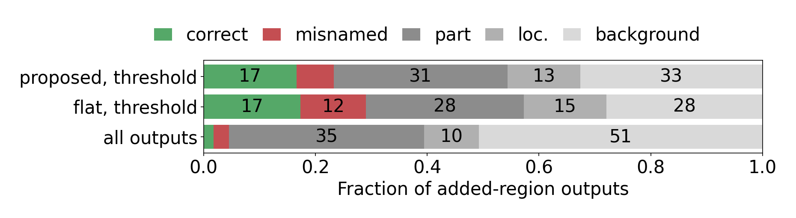

# report_021：論文の課題の改善（ex015b），論文の再構成とスライドの更新

## 1. 概要

order_021では，`paper_2026B` について挙げた6つの課題を，実験・論文・スライドで改善した．

| 課題 | 対応 |
| :--- | :--- |
| 1. 版を重ねた記録に見える | 題目・要旨・はじめに・考察・おわりにを，主張1本に絞って書き直した．COCOでのCLIP・SigLIPの比較は予備実験の1節にまとめた |
| 2. 中心の数字が弱い | 誤りを種類ごとに分け，GTと重なる領域だけを残した場合の上限を求めた．その上で，実用上の水準を考察で正直に述べた |
| 3. 他の手法との比較が無い | 1語を選ぶ方法（flat）と，評価の語彙（LVIS）を事前に与える方法と比べた |
| 4. 評価指標が独自 | ラベルの正誤だけによるCOCO形式のAP（AP_exact，AP_named）を加えた．階層的な指標を使う理由も本文に書いた |
| 5. スコアの貢献の重心 | スコアを「粒度と出力の数を選ぶための正しさの確率」と位置付け直した |
| 6. seedが1つ | 画像を分け直した5回の試行と，ブートストラップによる95%信頼区間を加えた |

- **プログラム：** `programs/ex015b_baselines_robustness/`（`data.py`，`model.py`，`train.py`）．ex015の比較手法と評価の追加のため，通し番号015を維持した．
- **再学習：** 物体認識モデルと埋め込みモデルは再学習していない．スコアの重みだけを，各分割の検証用の画像で求め直した．

## 2. 実験条件（ex015b）

- **共通の設定：** ex015で選んだ設定（ensの文章，人の役割を除く，β = 2，τ = 0.1，K = 100）．YOLO11xのボックスの出力は全ての方法で同じで，加えた領域の命名だけが異なる．
- **命名の方法：**

| 名前 | 語彙 | 規則 |
| :--- | :--- | :--- |
| greedy（提案） | キャプションの7806語 | 上位語へ集約し，確信度 τ 以上の間だけ下位語へ進む |
| flat | キャプションの7806語 | 確率が最大の1語をそのまま出力する |
| greedy_lvis（参考） | LVISの1203カテゴリ名 | greedy |
| flat_lvis（参考） | LVISの1203カテゴリ名 | flat（オープンボキャブラリ検出器の通常の使い方） |
| {greedy, flat}_oracle（分析） | キャプション | GTとIoU 0.5以上で重なる加えた領域だけを残す（GTを使うため，手法ではなく上限の見積もり） |

- **スコア：** det（検出のスコア）と calibrated（ex015aと同じ9個の重みのロジスティック回帰）．重みは方法ごとに求めた．
- **指標：**
  - 既存：AP_fed，AP_strict（階層的な適合率・再現率），ECE
  - 追加：AP_exact（出力がGTのSynset自身か下位語の場合のみ正解），AP_named（GTの上位語・自身・下位語なら正解）．どちらもIoU 0.5，カテゴリを区別しないCOCO形式のAPで，GTと対応しない出力は全て誤りとした．
- **ばらつき：**
  - 元の分割（seed 42）に加え，検証用とテスト用の画像（2387枚と2365枚）を合わせ，seed 0〜4で半分ずつに分け直した．各回でスコアの重みと閾値を求め直した．
  - 元のテスト用の画像で，画像単位の復元抽出1000回のブートストラップを行い，差の95%区間を求めた（STとFT）．
- **誤りの分解：** 加えた領域の出力を次の6種類に分けた．
  - 正しい命名，誤った命名，重複
  - 物体の一部：領域の面積の80%以上がGTのボックスに含まれる
  - 位置ずれ：最大のIoUが0.1以上0.5未満
  - 背景：それ以外
- **実行時間：** 初回は約32分（ブートストラップを含む）．oracleの追加は約4分（結果がある条件は読み込んで飛ばす）．

## 3. 結果（テスト用）

### 3.1 命名の方法の比較（`table_seeds.csv`，5回の平均±標準偏差，スコアは calibrated）

| OWLv2 | 方法 | AP_fed | AP_strict | AP_exact | AP_named |
| :--- | :--- | :---: | :---: | :---: | :---: |
| ST | flat | 0.297±0.005 | 0.183±0.004 | 0.097±0.005 | 0.128±0.003 |
| ST | **greedy** | **0.321±0.004** | **0.186±0.003** | 0.089±0.004 | **0.133±0.003** |
| ST | flat_lvis | 0.341±0.005 | 0.198±0.004 | 0.107±0.004 | 0.137±0.003 |
| ST | greedy_lvis | 0.344±0.005 | 0.198±0.004 | 0.103±0.004 | 0.135±0.003 |
| ST-L | flat | 0.306±0.004 | 0.180±0.003 | 0.099±0.004 | 0.129±0.003 |
| ST-L | greedy | 0.327±0.004 | 0.183±0.002 | 0.097±0.004 | 0.130±0.004 |
| FT | flat | 0.420±0.004 | 0.255±0.002 | 0.152±0.005 | 0.188±0.004 |
| FT | greedy | 0.447±0.006 | 0.269±0.003 | 0.152±0.005 | 0.198±0.003 |
| FT | flat_lvis | 0.505±0.004 | 0.305±0.004 | 0.207±0.003 | 0.238±0.002 |
| FT | greedy_lvis | 0.503±0.004 | 0.303±0.004 | 0.202±0.003 | 0.234±0.002 |

**ブートストラップ（元のテスト用の画像，差と95%区間，`bootstrap_{st,ens}.json`）：**

| 比較 | OWLv2 | AP_fed | AP_strict | AP_exact | AP_named |
| :--- | :--- | :---: | :---: | :---: | :---: |
| greedy − flat（calibrated） | ST | +0.027（0.021〜0.035） | +0.004（0.001〜0.009） | −0.008（−0.010〜−0.007） | +0.006（0.003〜0.009） |
| greedy − flat（calibrated） | FT | +0.026（0.017〜0.036） | +0.013（0.008〜0.019） | +0.001（−0.003〜0.005） | +0.011（0.007〜0.016） |
| calibrated − det（greedy） | ST | +0.011（0.008〜0.013） | +0.026（0.021〜0.031） | +0.023（0.019〜0.027） | +0.039（0.034〜0.044） |
| calibrated − det（greedy） | FT | +0.018（0.014〜0.023） | +0.034（0.028〜0.041） | +0.042（0.036〜0.048） | +0.052（0.046〜0.059） |
| greedy_lvis − flat_lvis | FT | −0.003（−0.006〜−0.001） | −0.003（−0.004〜−0.001） | −0.006（−0.008〜−0.004） | −0.005（−0.007〜−0.003） |

**同じ領域での命名（`paired_naming_*.json`）：** 検出のスコアの順でCOCO外の物体と対応した加えた領域について，命名が正しかった割合を比べた．

| OWLv2 | 領域数 | flat | greedy | greedyのみ正しい | flatのみ正しい |
| :--- | :---: | :---: | :---: | :---: | :---: |
| ST | 6385 | 25.9% | **43.0%** | 1551 | 457 |
| ST-L | 6278 | 29.7% | 42.2% | 1073 | 287 |
| FT | 8415 | 48.9% | 56.2% | 1247 | 635 |

- **greedyのみ正しい例：** jersey（flat：jersey，greedy：shirt），skirt（short pants／garment），ring（band／jewelry）
- **flatのみ正しい例：** handle（knob／fastener）．greedyが最初の段階で誤った枝に進んだ．

### 3.2 スコアのばらつき（ST，greedy）

| スコア | AP_strict（seed 42） | AP_strict（5回） | ECE（5回） |
| :--- | :---: | :---: | :---: |
| det | 0.171 | 0.165±0.003 | 0.136±0.006 |
| calibrated | 0.197 | 0.186±0.003 | 0.019±0.003 |

### 3.3 誤りの分解（`errors.json`，元の分割，%）

| 構成 | 出力数 | 正しい | 誤り | 重複 | 一部 | 位置ずれ | 背景 |
| :--- | :---: | :---: | :---: | :---: | :---: | :---: | :---: |
| ST greedy 全て | 220899 | 1.8 | 2.3 | 0.5 | 35.0 | 9.8 | 50.8 |
| ST greedy 閾値 | 4657 | 16.6 | 5.8 | 0.9 | 31.1 | 13.0 | 32.6 |
| ST flat 閾値 | 3763 | 17.3 | 11.0 | 0.7 | 28.2 | 14.8 | 27.9 |
| FT greedy 閾値 | 14489 | 26.6 | 10.0 | 0.4 | 23.2 | 8.4 | 31.5 |

**上限の見積もり（oracle，calibrated，元の分割）：**

| OWLv2 | 方法 | AP_strict（通常） | AP_strict（oracle） | AP_exact（oracle） | AP_named（oracle） |
| :--- | :--- | :---: | :---: | :---: | :---: |
| ST | greedy | 0.197 | 0.265 | 0.111 | 0.197 |
| ST | flat | 0.193 | 0.237 | 0.121 | 0.161 |
| ST-L | greedy | 0.191 | 0.264 | 0.128 | 0.184 |
| ST-L | flat | 0.188 | 0.239 | 0.126 | 0.163 |
| FT | greedy | 0.277 | 0.401 | 0.228 | 0.306 |
| FT | flat | 0.264 | 0.365 | 0.222 | 0.270 |

### 3.4 分かったこと

- **スコアの改善は偶然ではない：**
  - 3つの重みの全てで，AP_strict の差の95%区間は0を含まなかった（ST：+0.021〜+0.031，FT：+0.028〜+0.041）．
  - 分け直した5回でも，ST の AP_strict は0.165±0.003 → 0.186±0.003だった．
- **上位語への集約は領域ごとの命名を大きく改善するが，APへの寄与は小さい：**
  - 同じ領域で比べると，ST の命名の正解率は25.9% → 43.0%だった．
  - 一方，AP_strict の差は0.004（ST）〜0.013（FT）と小さかった．
  - LVISのカテゴリまで正しい出力だけを数える AP_exact では，ST で flat が0.008上回った．greedy の改善の多くは，誤った細かい語を正しい粗い語に置き換えたものである．
- **評価の語彙を事前に与えると，集約の効果は無い：** flat_lvis と greedy_lvis はほぼ同じで，FT では flat_lvis がわずかに有意に高かった．提案が有効なのは，語彙を事前に知らず大きな語彙から命名する場合に限られる．
- **誤りの主な要因は領域の追加である：**
  - 閾値以上の出力でも，物体の一部・位置ずれ・背景が76.7%を占め，誤った命名は5.8%だった．
  - GTと重なる領域だけを残すと，AP_strict は0.197 → 0.265に上がった．
  - このとき greedy と flat の差も0.004 → 0.028に広がった．FT では AP_exact でも greedy が上回った（0.228 対 0.222）．
- **実用上の水準：** ST で選んだ閾値での加えた領域の適合率は16.6%，COCO外の物体の命名は3.2%である．そのまま人手のアノテーションの代わりにはならない．校正したスコアで候補を絞り，人が確認する用途にとどまる．

## 4. 論文（`paper_2026B/main.pdf`，10ページ）

- **赤字の扱い：** order_020の赤字を黒字に戻し，今回の修正を赤字にした．
- **題目：** 「WordNetの上位語への確率の集約による再学習なしの粒度可変アノテーション」に変えた．
- **要旨・はじめに・おわりに：** 主張を「再学習なしで，学習時に無い物体に，正しさの確率付きで確信度に応じた粒度の名前を付ける」の1本に絞って書き直した．貢献は3点にまとめた．
- **関連研究：** 2.4節「階層的な分類と確信度」を追加し，Hedging Your Bets，CHiLS，Platt scaling，温度スケーリングを引用した．Bootstrapの文献も加えた．
- **提案手法：** 3.1節を基本の手法，3.3節を提案手法とする見出しに変えた．スコア（S）の目的は「粒度と出力の数を選ぶための確率」と明記した．
- **実験の構成：**

| 節 | 内容 |
| :--- | :--- |
| 4.2 | 予備実験（旧4.2〜4.4を統合．θ の図は文章に要約） |
| 4.3 | 評価の方法（AP の定義，階層的な指標を使う理由，AP_exact と AP_named，5回の試行，ブートストラップ） |
| 4.4 | 分類の能力と設定の影響（旧4.5．重みの比較の表は文章に要約） |
| 4.5 | 命名の方法の比較（新規，表5） |
| 4.6 | スコアの評価（信頼区間と5回の試行を追記） |
| 4.7 | 誤りの分解（新規，表7，oracle） |

- **考察：** 5.1 予備実験，5.2 集約の効果と限界，5.3 実用上の水準と誤りの要因，5.4 今後の課題，の構成で書き直した．
- **ページ数：** 10ページ（前回と同じ）に収めた．そのため次の3点を本文に要約した．
  - 図2（θ の影響）
  - トレードオフの図
  - 重みの比較の表
- **コンパイル：** `latexmk -pdfdvi`．overfull box と未定義の参照は無い．

## 5. スライド（`slides_2026B.pptx`，`slides_2026B.pdf`，21枚）

- **想定：** 研究室のゼミ・研究会．約20分．聴衆は物体認識や埋め込みモデルの基礎を知る研究者・学生．
- **変更：**
  - 題目を論文に合わせた．
  - 追加した3枚：15枚目（同じ領域での命名の比較），16枚目（命名の方法の AP の表），19枚目（誤りの分解）
  - スコアの表に，5回の試行と信頼区間を追記した．
  - まとめと今後の課題を更新した．
- **規約：** 本文28，注釈24，図表20ポイント．数式はOMML．pptx-renderでPDF化し，追加と変更したスライドを目視で確認した．

## 6. 作成・変更したファイル

| ファイル | 内容 |
| :--- | :--- |
| `.orders/order_021.md` | 指示と解釈 |
| `programs/ex015b_baselines_robustness/` | ex015b |
| `tests/test_baselines_robustness.py` | ラベルの AP，ブートストラップ，包含の割合．3件．全テスト53件が合格 |
| `outputs/ex015b_baselines_robustness/` | 結果，ログ（`run.log`，`run_oracle.log`） |
| `paper_2026B/` | `main.tex`（題目），`sections/*.tex`，`main.pdf` |
| `slides/build_slides_2026B.py`，`slides/media_2026B/` | スライド（`paired.png`，`errors.png` を追加） |
| `slides_2026B.pptx`，`slides_2026B.pdf` | 発表スライド |
| `visualize_result.ipynb` | ex015bのセルを追加して実行した（`summary_seeds.csv`，`summary_errors.csv`，`fig_methods.png`） |
| `document.md` | ex015bを追記した |

## 7. 未解決の論点と次の候補

- **物体でない領域の棄却（最優先）：** oracle で AP_strict が0.197 → 0.265になったため，最も効果が大きい．候補の特徴は次のとおりで，いずれも未検証である．
  - YOLOのボックスとの包含関係
  - 領域の大きさ
  - 加えた領域どうしの重なり
- **細かい語の正解の増加：** AP_exact で flat に劣る．領域の特徴の分類能力を上げる必要がある（大きい埋め込みモデルとの統合等）．
- **ブートストラップの範囲：** 信頼区間はSTとFTのみで求め，ST-Lでは求めていない．
- **LVISの網羅性：** 物体の一部・背景には，注釈の無い正しい物体も含まれる．人手による確認は行っていない．
- **校正の分布依存：** スコアの重みはLVISの検証用の画像で求めた．LVIS以外の画像での校正は未評価である．
- **論文の投稿先：** 投稿先・ページ数の制限・締切は指示されていない．現在の10ページは前回と同じ分量である．
- **ai-agent による検証：** `tokens.json` が無いため，行っていない．
