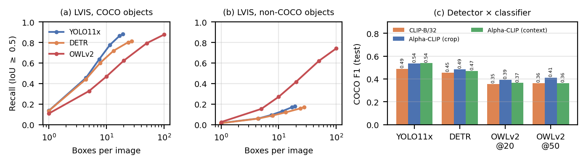

# report_039：検出器と分類器の比較を加えた論文とスライドの作り直し（paper_2026C，slides_2026C）

## 1. 概要

- **目的：** 提案手法（OWLv2 ＋ Alpha-CLIP ＋ WordNet・Visual Genome（VG）の語彙の木）の中で，検出器（OWLv2，YOLO11x，DETR）と分類器（Alpha-CLIP，CLIP）を比較し，どの検出器の精度が高いかと OWLv2 を選ぶ理由を示す．その結果で論文 `paper_2026C` とスライド `slides_2026C` を作り直す．研究の目的（再学習なしの粒度可変の物体アノテーション）は変えていない．
- **新しい実験：** 提案手法の中で検出器だけを YOLO11x や DETR に替えた結果はこれまでに無かった（ex019 の YOLO11x ＋ F は order_032 で削除し，order_037 の E2 は中止）．そのため，推論のみの比較実験 E3_detector を ex021 に追加した（`python train.py e3`）．YOLO11x と DETR は自身のクラスを用いず，ボックスと検出スコア（物体らしさ $`o_k`$ の代わり）だけを用いる．
  - 検出器 D：OWLv2（20個/枚，50個/枚），YOLO11x（conf 0.25），DETR（閾値 0.5）
  - 分類器 F：CLIP-ViT-B/32，Alpha-CLIP（crop），Alpha-CLIP（context1.5）
  - 棄却の判定：提案（$`m_{c_k} o_k`$，NMS＋包含の除去，部分木の確率の合計によるラベル）と従来（$`q_k o_k`$，除去なし，COCO のラベル）
  - θ は dev の F値で選び，test で評価した．差の検定は画像単位の対応のあるブートストラップ（1000回）である．
- **COCO 外の物体の照合：** E3 の test の残したボックスと棄却前の全てのボックスを，同じ画像の LVIS v1 の注釈（474枚，COCO 外の物体2687件）と照合した（`python train.py e3lvis`）．
- **検出器のみの表：** ex022 に，OWLv2 の20個と50個を加えた4つの検出器の表 `table_detector_all.csv` を追加した．

## 2. 表の記号

論文の表1にも同じ一覧を載せ，各表の説明文にも記号の意味を書いた．

| 記号 | 名前 | 説明 |
| :--- | :--- | :--- |
| N | ボックス数 | 1枚あたりのボックス数（棄却の後は残した数） |
| $`R_{\mathrm{all}}`$ | 検出の再現率 | クラスを問わず，IoU 0.5 以上のボックスがある GT の割合 |
| $`R_{\mathrm{per}}`$，$`R_{\mathrm{oth}}`$ | 人物・人物以外の再現率 | $`R_{\mathrm{all}}`$ を人物の GT，人物以外の GT に限った値 |
| $`R_{\mathrm{N}}`$ | COCO 外の物体の再現率 | LVIS の COCO 外の物体を囲んだ割合 |
| E | GT に当たらない割合 | どの GT とも IoU 0.5 以上で重ならないボックスの割合 |
| t | 時間 | 1枚あたりの検出の時間（秒） |
| Top-1 | ラベルの正解率 | 対応したボックスのうち，ラベルが GT のクラスと一致した割合 |
| P，R，F | 適合率，再現率，F値 | ラベルも一致した組を正解とする（COCO の80クラス） |
| hP，hR，hF | 階層的適合率・再現率・F値 | キャプションによる細かい正解（912件）に対する値 |
| $`R_{\mathrm{p}}`$ | 人物の再現率 | 人物の GT のうち，対応したボックスを残した割合 |
| Acc | 命名の正解率 | 細かい正解と一致，それより細かい語，または正しい上位語を出力した割合 |
| Fine | 細かい語の正解率 | 正しく COCO のクラスより細かい語を出力した割合 |

## 3. 結果

### 3.1 検出器のみの比較（test，`outputs/ex022_yolo_detr_region_check/table_detector_all.csv`，`E3_detector/lvis_test.csv`）

| 検出器 | N | $`R_{\mathrm{all}}`$ | $`R_{\mathrm{per}}`$ | $`R_{\mathrm{oth}}`$ | E | $`R_{\mathrm{N}}`$ | t [s] |
| :--- | ---: | ---: | ---: | ---: | ---: | ---: | ---: |
| YOLO11x | 6.2 | 0.702 | 0.800 | 0.657 | **0.201** | 0.100 | **0.016** |
| DETR | 11.2 | 0.738 | 0.828 | 0.697 | 0.475 | 0.124 | 0.049 |
| OWLv2（20個） | 18.4 | 0.700 | 0.541 | 0.774 | 0.739 | 0.519 | 0.232 |
| OWLv2（50個） | 46.6 | **0.875** | **0.883** | **0.871** | 0.867 | **0.734** | 0.232 |

- COCO の物体の再現率は OWLv2（50個）が最も高く，COCO 外の物体を囲めるのは OWLv2 のみである．
- 一方，OWLv2 は箱が多く，87%は GT に当たらない．
- ex010（LVIS の2148枚）では，YOLO11x と DETR は閾値を下げても20〜30個で箱が尽き，COCO 外の物体の再現率は0.18以下であった．OWLv2 は100個で0.743であった（論文の図2(a)(b)）．

### 3.2 提案手法の検出器を替えた比較（test，F は Alpha-CLIP（crop），`outputs/ex021_coco_owl_rejection/E3_detector/summary_test.csv`）

| 検出器 | 判定 | N | Top-1 | P | R | F | hF | $`R_{\mathrm{p}}`$ | $`R_{\mathrm{N}}`$ |
| :--- | :--- | ---: | ---: | ---: | ---: | ---: | ---: | ---: | ---: |
| YOLO11x（箱のみ） | 提案 | 4.1 | 0.810 | **0.721** | 0.426 | **0.535** | 0.502 | 0.726 | 0.058 |
|  | 従来 | 5.1 | 0.662 | 0.548 | 0.401 | 0.463 | 0.477 | 0.644 | 0.087 |
| DETR（箱のみ） | 提案 | 5.3 | **0.819** | 0.562 | **0.428** | 0.486 | **0.521** | **0.739** | 0.061 |
|  | 従来 | 6.3 | 0.671 | 0.403 | 0.368 | 0.385 | 0.451 | 0.482 | 0.077 |
| OWLv2（20個） | 提案 | 4.4 | 0.777 | 0.507 | 0.322 | 0.394 | 0.428 | 0.421 | 0.094 |
|  | 従来 | 4.2 | 0.814 | 0.441 | 0.265 | 0.331 | 0.255 | 0.082 | 0.091 |
| OWLv2（50個） | 提案 | 5.3 | 0.796 | 0.472 | 0.363 | 0.411 | 0.461 | 0.545 | 0.103 |
|  | 従来 | 5.0 | 0.789 | 0.393 | 0.286 | 0.331 | 0.279 | 0.104 | 0.118 |
| Old（DETR＋CLIP） | $`q_k`$ | 6.6 | 0.680 | 0.389 | 0.368 | 0.378 | 0.466 | 0.517 | – |
| YOLO11x 単体 | 検出スコア | 5.7 | 0.976 | 0.796 | 0.655 | 0.719 | 0.670 | 0.766 | – |

- COCO の80クラスによる F値は，YOLO11x の箱（0.535）＞ DETR の箱（0.486）＞ OWLv2（50個，0.411）であった．OWLv2（50個）との差は，YOLO11x が0.125（95%区間［0.106，0.145］），DETR が0.075（［0.056，0.095］）で，いずれも p = 0.001 であった（`paired_bootstrap_test.csv`）．hF も YOLO11x と DETR が0.04〜0.06高い．
- OWLv2 の F値が低い主な原因は適合率である．OWLv2（50個）で残した箱の41.3%は COCO の GT に当たらず，そのうち13.1%は LVIS の COCO 外の物体を囲んでいた（YOLO11x 7.0%，DETR 3.4%）．LVIS の注釈は網羅的でないため，これは下限である．
- 残した箱の $`R_{\mathrm{N}}`$ は OWLv2 が最も高いが，棄却前の0.734から0.103に低下した．θ を COCO の F値で選び，深さ0のラベルを COCO のクラスから選ぶためである．
- 提案の判定は，全ての検出器で従来の判定より F値を0.06〜0.10高めた．

### 3.3 分類器の比較（test）

| 分類器 | Top-1（GT） | Top-5（GT） | hF（GT） | F（YOLO11x） | F（DETR） | F（OWLv2 20個） | F（OWLv2 50個） |
| :--- | ---: | ---: | ---: | ---: | ---: | ---: | ---: |
| CLIP（B/32） | 0.497 | 0.738 | 0.576 | 0.490 | 0.454 | 0.354 | 0.364 |
| Alpha-CLIP（crop） | **0.527** | 0.766 | – | 0.535 | **0.486** | **0.394** | **0.411** |
| Alpha-CLIP（context） | **0.527** | **0.817** | **0.639** | **0.538** | 0.470 | 0.365 | 0.365 |

GT の列は正解ボックスでの値（ex019 の E1，ex020 の E1_gt．hF は部分木の確率の合計による命名．–：未評価）である．右の4列は各検出器と組み合わせた F値（提案の判定）である．

- Alpha-CLIP（crop）は，全ての検出器で CLIP より F値が0.032〜0.047高かった（いずれも p ≤ 0.001）．Top-1 も0.03〜0.07高い．
- Alpha-CLIP（context）は，YOLO11x では＋0.048であったが，OWLv2 では CLIP との差が有意でなかった．周囲の物体の名前が付きやすいためである．
- 検出器と組み合わせた hF の差は，いずれの組でも有意でなかった．

## 4. 考察（OWLv2 を選ぶ理由）

- **COCO の物体：** COCO で学習した YOLO11x と DETR は少ない箱で物体を囲み，誤検出も少ない．そのため，COCO の80クラスによる評価では，YOLO11x の箱を用いる構成の F値が最も高い．
- **COCO 外の物体：** YOLO11x と DETR は，閾値を下げても COCO 外の物体をほとんど囲めない．
- **OWLv2 を選ぶ理由：**
  - 本研究の目的は，再学習なしで，80クラスより細かい語や80クラスの外の語で物体を注釈することである．
  - 検出器が囲まない物体は，分類器や語彙の木を改善しても注釈できない．つまり検出器の再現率が，注釈できる物体の上限を決める．
  - OWLv2 は，COCO の物体の87.5%と COCO 外の物体の73.4%を囲む唯一の検出器であり，ボックス数で再現率を調整できる．
- **課題：** 現在の棄却の判定（COCO のクラスのラベルと COCO の F値による θ）では，COCO 外の物体の箱が棄却され，OWLv2 の利点が生かされていない．論文の考察には，COCO 外の枠の部分木の確率の合計を使うこと，COCO 外の物体を含む注釈で θ を選ぶこと，YOLO11x と OWLv2 の箱を組み合わせることを今後の課題として書いた．

## 5. 論文とスライドの変更

- **論文 `paper_2026C/main.pdf`（6ページ → 8ページ）：**
  - 題名を「再学習を必要としない粒度可変物体アノテーションにおける検出器と分類器の比較および棄却の判定」に変更した．
  - 要旨，はじめに（貢献を「検出器の比較」「分類器の比較」「棄却の判定」の3点に変更），提案手法（検出器と分類器の置き換えの記述）を変更した．
  - 実験：表1（記号と評価指標）を追加した．4.2節「検出器の比較」（表2，図2，表3），4.3節「分類器の比較」（表4）を追加した．
  - 考察：5.1節「検出器の選択」（OWLv2 を選ぶ理由），5.2節「分類器の選択」を追加した．
  - 旧版の表1（主な結果）は表3に統合し，その数値（0.326 → 0.411，Old との差 p = 0.018 など）を4.4節の本文に移した．
  - 参考文献に LVIS を追加した．`latexmk` で Overfull と未定義の参照が無いことを確認した．
- **スライド `slides_2026C.pptx` と `slides_2026C.pdf`（15枚 → 18枚）：**
  - 4枚目に記号の表を追加した．
  - 5〜9枚目に，検出器のみの比較，LVIS の曲線，検出器を替えた比較，OWLv2 を選ぶ理由，分類器の比較を追加した．
  - 表の下には記号の説明を付けた．
  - 旧版の「実験条件」「主な結果」「評価指標」の3枚は削った．
  - `.ai/pptx-render` で PDF を作り，見出しの2行への折り返しと語の途中での改行が無いことを確認した．
- **対象：** 投稿先とページ数の指定は無い．論文は order_034 と同じ ieicejsp の和文の2段組とした．スライドは研究室の進捗報告（約15〜20分）を想定した．

## 6. 生成物

| 種類 | パス |
| :--- | :--- |
| プログラム | `programs/ex021_coco_owl_rejection/train.py`（`run_e3`，`significance_e3`，`train_e3`，`kept_boxes`，`lvis_counts`，`train_e3_lvis`），`data.py`（ex018 の読み込み），`programs/ex022_yolo_detr_region_check/train.py`（`detector_table_all`） |
| 結果 | `outputs/ex021_coco_owl_rejection/E3_detector/`（`summary_test.csv`，`paired_bootstrap_test.csv`，`lvis_test.csv`），`outputs/ex022_yolo_detr_region_check/table_detector_all.csv` |
| 論文 | `paper_2026C/main.pdf`，`sections/*.tex`，`make_figures.py`（`fig_detector` を追加），`figures/fig_detector.{pdf,png}` |
| スライド | `slides_2026C.pptx`，`slides_2026C.pdf`，`slides/build_slides_2026C.py`，`slides/media_2026C/lvis.png` |
| テスト | `tests/test_ex021_rejection.py`（`test_e3_grid_names_unique` を追加），`tests/test_ex022_yolo_detr.py`．計7件，全て成功 |

## 7. 未解決の論点

- **COCO 外の物体の命名の評価：** COCO 外の物体の箱を残せるか（$`R_{\mathrm{N}}`$）は測ったが，残した箱に付けた語の正しさは評価していない．
- **COCO 外の物体を残す棄却の判定：** 深さ0のラベルを COCO のクラスに限らない判定や，LVIS で θ を選ぶ判定は未検討である．
- **YOLO11x と OWLv2 の箱の併用：** COCO の物体は YOLO11x，COCO 外の物体は OWLv2 で囲む構成は未実施である．
- **LVIS の注釈：** 網羅的でないため，$`R_{\mathrm{N}}`$ と誤検出の内訳は概算である．
- **Alpha-CLIP（crop）の正解ボックスの hF：** ex020 で評価していないため，論文の表4は「–」とした．
- **定性評価の図：** 検出器を替えた構成（YOLO11x ＋ Alpha-CLIP など）の出力例は作っていない．
- **論文の表記：** 論文の表記を「従来の判定」「提案の判定」に統一し，スライドもこれに合わせた（report_036 の「改良前」「改良後」から変更）．
