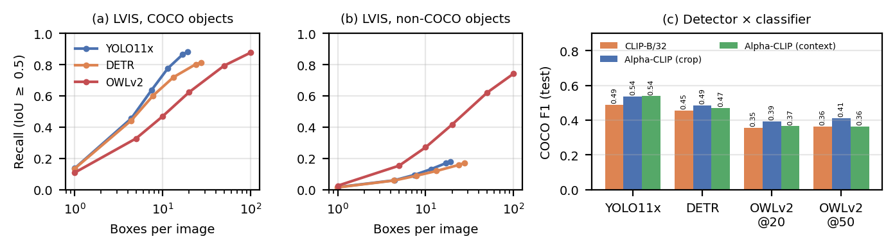
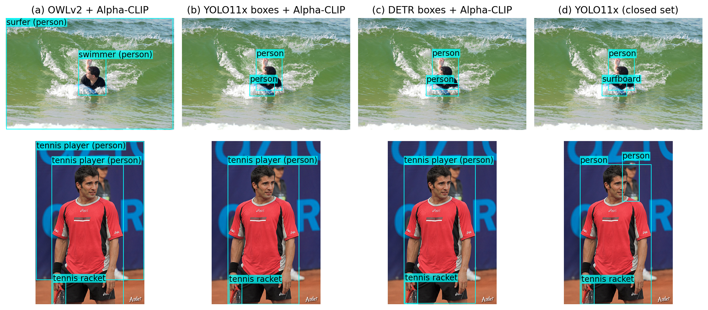

# report_040：論文とスライドをモデル中心の構成に組み替え

## 1. 実施内容
order_039 の論文（`paper_2026C/main.pdf`）とスライド（`slides_2026C.pptx`）は，棄却のスコアの比較が中心になっていた．
研究の目的である「再学習なしで粒度を変更できるモデル」を中心とする構成に組み替え，棄却のスコアは今後の課題とした．
新しい実験は行っておらず，既存の結果（ex010，ex020，ex021 の E1・E3，ex022）を用いた．

| 対象 | 変更 |
| :--- | :--- |
| 題名 | 「OWLv2，Alpha-CLIPと語彙の木を用いた再学習を必要としない粒度可変の物体アノテーション」 |
| 貢献 | ① 検出器の比較と OWLv2 を選ぶ理由，② 分類器の比較，③ 語彙の木（部分木の確率の合計）による粒度の判断 |
| 手法 | 「棄却のスコア」の節を「深さ0のラベルと残すボックス」に縮め，規則は全ての構成に共通で，設計は今後の課題と明記した．粒度の変更の節に例を加えた |
| 実験 | 棄却の判定の評価（120通りの組，要因の表 tab_ablation，図 fig_rejection）を削除した．検出器を替えた表（tab_pipeline）から「従来の判定」の行を除き，Acc と Fine の列を加えた |
| 分類器 | Alpha-CLIP は細かく正しい語の割合（Fine）が CLIP の約2倍で，命名の正解率（Acc）は CLIP の方が高いことを追記した |
| 定性の図 | 「従来と提案の判定」の比較を，検出器を替えたモデルの出力（OWLv2，YOLO11x の箱，DETR の箱，YOLO11x 単体）に変えた．ラベルは「細かい語（深さ0の語）」の2つの粒度で表示する |
| 考察 | 「部分木による棄却」を「語彙の木による粒度の判断」に変えた．限界の節に，残す規則のため COCO 外の物体の再現率が 0.734→0.103 に落ちることと，棄却のスコアの設計を今後の課題として記述した |
| 表記 | ai-tex-kit の修正依頼の規約に従い，修正箇所を赤字にした（`\rev{}`） |

## 2. 論文に使った主な結果（テスト用の500枚）

### 検出器を替えた比較（分類器は Alpha-CLIP（crop））
| 検出器 | N | Top-1 | P | R | F | hF | Acc | Fine | R_N |
| :--- | ---: | ---: | ---: | ---: | ---: | ---: | ---: | ---: | ---: |
| YOLO11x（ボックスのみ） | 4.1 | 0.810 | 0.721 | 0.426 | 0.535 | 0.502 | 0.363 | 0.123 | 0.058 |
| DETR（ボックスのみ） | 5.3 | 0.819 | 0.562 | 0.428 | 0.486 | 0.521 | 0.385 | 0.136 | 0.061 |
| OWLv2（B=20） | 4.4 | 0.777 | 0.507 | 0.322 | 0.394 | 0.428 | 0.235 | 0.104 | 0.094 |
| OWLv2（B=50） | 5.3 | 0.796 | 0.472 | 0.363 | 0.411 | 0.461 | 0.274 | 0.111 | 0.103 |
| Old（DETR＋CLIP） | 6.6 | 0.680 | 0.389 | 0.368 | 0.378 | 0.466 | 0.467 | 0.060 | – |
| YOLO11x単体 | 5.7 | 0.976 | 0.796 | 0.655 | 0.719 | 0.670 | 0.816 | 0 | – |

記号の意味は次の通りである．
- N：残した数，Top-1：ラベルの正解率
- P：適合率，R：再現率，F：F値（COCO の80クラス）
- hF：細かい粒度の階層的F値，Acc：命名の正解率，Fine：正しく COCO のクラスより細かい語を出力した割合
- R_N：残したボックスの COCO 外の物体の再現率

### 分類器の Fine（細かく正しい語の割合）
| 検出器 | CLIP（B/32） | Alpha-CLIP（crop） |
| :--- | ---: | ---: |
| YOLO11x | 0.053 | 0.123 |
| DETR | 0.059 | 0.136 |
| OWLv2（B=20） | 0.053 | 0.104 |
| OWLv2（B=50） | 0.055 | 0.111 |

Fine の差の検定は行っていない．
Acc は CLIP の方が 0.12〜0.20 高い．CLIP は person などの粗い語を出す割合が高く，Alpha-CLIP は細かい語を出す一方でその一部が誤りになる．

### 定性の図

- いずれの検出器でも，人物に swimmer，tennis player などの細かい語が付き，同時に深さ0の person も得られる．
- YOLO11x 単体は person しか出さない．
- OWLv2 は波全体などの大きな領域も囲み，surfer のような場面の語を付けることがある．

## 3. 成果物
- 論文 `paper_2026C/main.pdf`：7ページ（order_039 は8ページ）．latexmk の Overfull はなし．
- スライド `slides_2026C.pptx` と `slides_2026C.pdf`：14枚．
  - 棄却の5枚（課題，原因，部分木，スコアとラベル，要因の図）を削除し，「部分木の確率の合計で出力の深さを決める」を追加した．
  - pptx-render で文字の崩れが無いことを確認した．
- `paper_2026C/make_figures.py`：
  - `e3_config`，`two_level_label`，`kept_two_level` を追加し，`fig_qualitative` を引数で大きさを変えられるようにした．
  - `fig_rejection` は呼ばない（関数は残した）．
- テスト：`tests/test_paper_2026C_figures.py`（2件）を追加した．ex021・ex022 のテストと合わせて9件が通った．
- 変更前のバックアップ：
  - `/tmp/claude-1000/-home-user-workspace-bong/097f1326-9149-47d6-84e7-54fbda3cf0a0/scratchpad/sections_before_order040/`
  - `/tmp/claude-1000/-home-user-workspace-bong/097f1326-9149-47d6-84e7-54fbda3cf0a0/scratchpad/slides_2026C_before040.pptx`

## 4. 未解決の論点と次の候補
- **粒度の評価：** 主張の中心は粒度だが，評価の正解はキャプション由来で85%が人物である．
  - LVIS v1 の各カテゴリは WordNet の synset を持つ．LVIS の箱を正解にすれば，人物以外の約1,200クラスで深さごとの命名（hF，Acc，Fine）を再学習なしに評価できる（未実施）．
- **Fine の水準：** 細かく正しい語の割合は最大でも0.12〜0.15と低い．τ を変えたときの Acc と Fine の関係（粒度と正しさのトレードオフの曲線）は，論文では記述のみで，図にしていない．
- **棄却のスコア（今後の研究）：** 残す規則の θ を COCO の F で選ぶため，COCO 外の物体のボックスは残らない（R_N 0.734→0.103）．次の2点が候補である．
  - COCO 外の枠の部分木の確率を使うスコア
  - LVIS で θ を選ぶこと
- **検出器の併用：** YOLO11x と OWLv2 のボックスの組み合わせ（未実施）．
