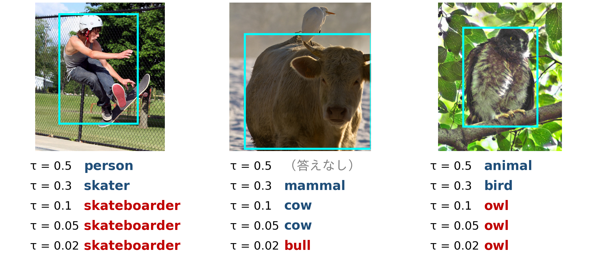
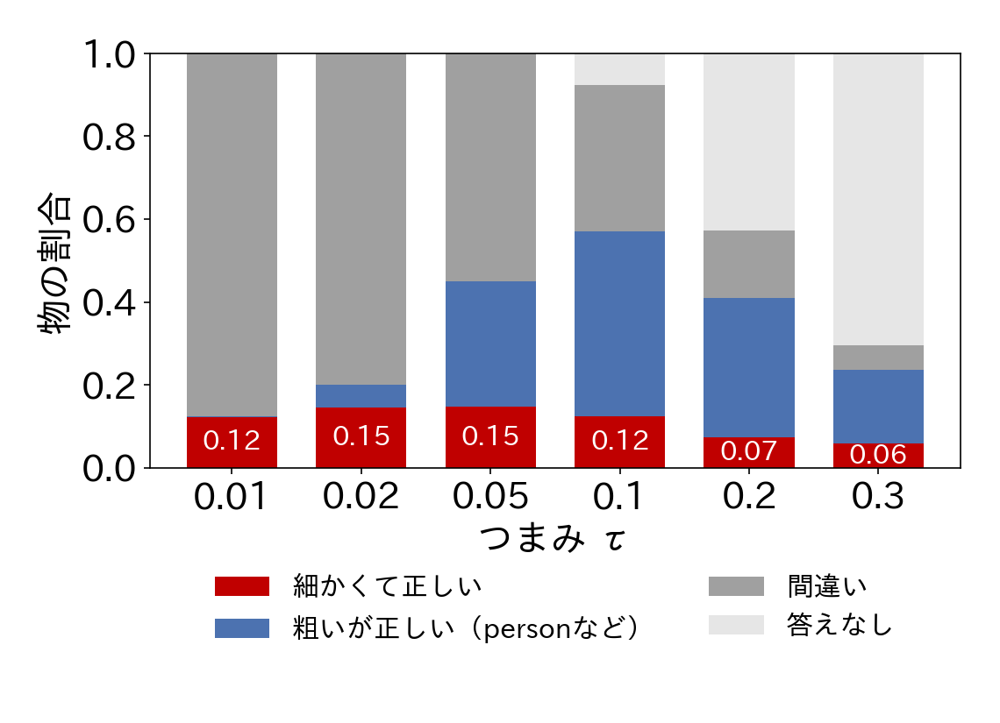

# report_044：研究結果が聴衆に簡単に伝わるようにスライドを改善

## 1. 目的と方針
order_043 までのスライドには，次の問題があった．
- 研究の中心である「再学習なしで粒度を変えられる」ことを，実際の出力で見せていなかった．
- 時間の多くが検出器の比較に使われていた．

そこで，次の4点を改善した．新しい学習と検出は行っておらず，既存の結果とキャッシュ済みの特徴量を用いた．論文は変更していない．

| 改善 | 内容 |
| :--- | :--- |
| ① τ を変えた例 | 同じ物体で τ を下げると，person → skater → skateboarder のように語が細かくなる様子を示した（9枚目） |
| ② 細かさと正しさのトレードオフ | τ ごとの出力の内訳を帯グラフにした（10枚目） |
| ③ 検出器の比較を縮める | 4枚を2枚にした．タイトルを「COCO外の物体を囲めるのは OWLv2 だけ」と「ただし，COCOのF値では YOLO・DETR の箱が有利」にした |
| ④ 限界を結果のスライドに書く | 残した箱では R_N が 0.734 → 0.103 に落ちること，細かく正しい語は最大15%であること，細かい正解の85%が人物であることを，該当するスライドに明記した |

## 2. 新しい構成（17枚 → 16枚）
| 枚 | タイトル | 役割 |
| :--- | :--- | :--- |
| 1 | 題名 | |
| 2 | 背景：再学習なしで，物体を細かい粒度で注釈したい | 目的 |
| 3 | 前稿のモデル：DETR＋CLIP＋WordNetの下位語 | 前稿と課題 |
| 4 | 前稿から現在のモデルへ：4つの点を更新した | 更新点と理由 |
| 5 | 更新の効果：COCO外を囲み，細かい語が増える | 前稿との比較 |
| 6 | 提案モデル：OWLv2＋Alpha-CLIP＋WordNet∩VGの木 | モデル（観点を「①τによる粒度 ②検出器 ③分類器」の順にした） |
| 7 | 部分木の確率の合計で，出力の深さ（粒度）を決める | 式 |
| 8 | 実験条件：COCOの画像で，検出から命名までを評価 | 記号の一覧表を，条件の箇条書きに変更（記号は各表の下で説明） |
| 9 | **τを下げると，同じ物体の語が細かくなる** | 新規：結果① |
| 10 | **τで，細かさと正しさのバランスを選べる** | 新規：結果① |
| 11 | 正解ボックスでも，部分木の合計が命名を改善する | 結果① |
| 12 | 検出器：COCO外の物体を囲めるのはOWLv2だけ | 結果②（LVIS の曲線と「OWLv2を選ぶ理由」を統合） |
| 13 | ただし，COCOのF値ではYOLO・DETRの箱が有利 | 結果②（R_N の低下を赤字で明記） |
| 14 | 分類器：Alpha-CLIP（crop）がCLIPを上回る | 結果③ |
| 15 | どの検出器でも，細かい語と深さ0の語が同時に得られる | 定性 |
| 16 | まとめ | 伝えたい結果を3つと課題に絞った |

削除したスライドは次の3枚である（内容は他のスライドに含まれる）．
- LVIS の曲線
- OWLv2 を選ぶ理由
- WordNet∩VG の木の1段ずつの正解率（person の子 398 → 136語は4枚目にある）

## 3. 新しい図

### τ を変えた例（9枚目）

- 条件：正解の箱，Alpha-CLIP（context1.5），T = 1．
- 出力：τ ごとに，部分木の確率の合計が τ 以上の最も深い語を出力した．
- 例の選び方：`slides/tau_examples_2026C.py` で，τ を下げると細かい正解の上位語を3つ以上たどって正解の語に至る物体を列挙した．912件のうち18件が該当し，その中から3件を選んだ．
- 注意：選んだ例であり，典型的な結果ではない．全体の傾向は次の図で示す．

### τ ごとの出力の内訳（10枚目）

ex020 の E1_gt（正解の箱，Alpha-CLIP context1.5，T = 1，テスト用の912件）の値である．

| τ | 細かく正しい | 正しい粗い語 | 誤り | 出力なし |
| ---: | ---: | ---: | ---: | ---: |
| 0.01 | 0.123 | 0.002 | 0.875 | 0 |
| 0.02 | 0.146 | 0.055 | 0.799 | 0 |
| 0.05 | 0.147 | 0.304 | 0.549 | 0 |
| 0.1 | 0.124 | 0.447 | 0.352 | 0.076 |
| 0.2 | 0.075 | 0.336 | 0.162 | 0.428 |
| 0.3 | 0.058 | 0.179 | 0.059 | 0.704 |

- τ を下げると細かい語が増えるが，誤りも増える．τ を上げると，粗い語と出力なしが増える．
- 細かく正しい語の割合は，最大でも約15%である．スライドでは課題として赤字で示した．

## 4. 実装と確認
- **追加したファイル：**
  - `slides/tau_examples_2026C.py`：τ の例を `slides/media_2026C/tau_examples.json` に保存する．追加の推論は，語彙の文章の特徴を求める処理のみである．
  - `tests/test_slides_tau_examples.py`（2件）．`tests/test_paper_2026C_figures.py` と合わせて4件が通った．
- **変更したファイル：** `slides/build_slides_2026C.py` に `fig_tau_examples()` と `fig_tau_tradeoff()` を加え，`build()` の構成を組み替えた．
- **確認：** pptx-render で `slides_2026C.pdf`（16枚）を作成した．全てのスライドで，文字のはみ出し，引用との重なり，単語の途中での改行がないことを目で確認した．
- **変更前のバックアップ：**
  - `/tmp/claude-1000/-home-user-workspace-bong/097f1326-9149-47d6-84e7-54fbda3cf0a0/scratchpad/slides_2026C_before044.pptx`
  - `/tmp/claude-1000/-home-user-workspace-bong/097f1326-9149-47d6-84e7-54fbda3cf0a0/scratchpad/build_slides_2026C_before044.py`

## 5. 未解決の論点
- **論文との対応：** 論文には，τ の例の図とトレードオフの図がまだない．スライドと揃える場合は，論文にも追加する必要がある．
- **設定の違い：** τ の図は T = 1 の値である．11枚目の命名の比較（hF 0.639）は，検証用で選んだ T = 1.5，τ = 0.05 の値であり，設定が異なる．質疑で問われた場合に備え，発表者は把握しておく必要がある．
- **細かい命名の正しさ：** 最大15%であり，研究の主張の弱点である．
