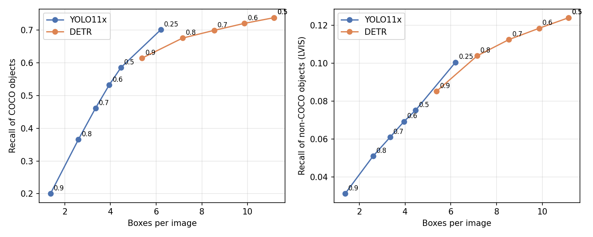

# report_049：YOLO11x と DETR の検出を，同じ閾値と同じ箱の数で比較

## 1. 目的
ex022 では，各検出器の既定の閾値で検出を比較した（YOLO11x 0.25，DETR 0.5）．ユーザーから「両方とも 0.5 にそろえた方が公平ではないか」との指摘があり，条件をそろえて比較し直した．

## 2. 方法（ex022b）
- **データ：** 新しい推論は行っていない．ex017 で保存した COCO val2017 の検出結果（dev・test 各500枚）を数え直した．
  - 保存されている箱は，YOLO11x がスコア 0.25 以上，DETR が 0.5 以上である．
  - そのため，両方を比べられる閾値は 0.5 以上である．
- **比較の条件：**

| 条件 | 内容 |
| :--- | :--- |
| 同じ閾値 | 両方を 0.5，0.6，0.7，0.8，0.9 にそろえる |
| 同じ箱の数 | DETR の閾値を，dev で1枚あたりの箱の数が YOLO11x（0.25 または 0.5）と同じになるように決める |
| 既定値 | YOLO11x 0.25，DETR 0.5（ex022 と同じ） |

- **指標：** クラスを問わず，IoU 0.5 以上で照合した．
  - COCO の物体の再現率（全体，人物，人物以外）
  - 正解に当たらない箱の割合（E）
  - LVIS の注釈による COCO 外の物体の再現率（test：474枚，2687件）

## 3. 結果（test）

### 同じ閾値
| 閾値 | 検出器 | 箱の数 | COCO の物体 | 正解に当たらない箱 | COCO 外の物体 |
| ---: | :--- | ---: | ---: | ---: | ---: |
| 0.5 | YOLO11x | 4.5 | 58.6% | 10.3% | 7.5% |
| 0.5 | DETR | 11.2 | 73.8% | 47.5% | 12.4% |
| 0.7 | YOLO11x | 3.3 | 46.2% | 6.5% | 6.1% |
| 0.7 | DETR | 8.5 | 70.0% | 39.1% | 11.2% |
| 0.9 | YOLO11x | 1.4 | 20.0% | 2.9% | 3.1% |
| 0.9 | DETR | 5.4 | 61.5% | 21.0% | 8.5% |

### 同じ箱の数
| 条件 | 検出器（閾値） | 箱の数 | COCO の物体 | 正解に当たらない箱 | COCO 外の物体 |
| :--- | :--- | ---: | ---: | ---: | ---: |
| 約6個 | YOLO11x（0.25） | 6.2 | **70.2%** | **20.1%** | 10.0% |
| 約6個 | DETR（0.843） | 6.4 | 65.6% | 27.8% | 9.6% |
| 約4.5個 | YOLO11x（0.5） | 4.5 | **58.6%** | **10.3%** | 7.5% |
| 約4.5個 | DETR（0.942） | 4.5 | 56.0% | 15.9% | 7.4% |

dev でも同じ傾向である．約6個の場合，YOLO11x は 68.5%，DETR は 63.4% であった．

## 4. 考察
1. **同じ閾値は公平な比較にならない．**
   - 閾値 0.5 では，DETR は YOLO11x の2.5倍の箱を出す．DETR の再現率が高いのは箱が多いためであり，DETR のスコアが全体に高い（中央値：YOLO11x 0.74，DETR 0.89）ことによる．
   - YOLO11x のスコアは物体らしさとクラスの確率を合わせた値であり，DETR のスコアはクラスのソフトマックス確率である．計算方法が異なるため，同じ 0.5 でも意味が異なる．
2. **同じ箱の数では，YOLO11x が少し良い．** 同じ数の箱で，YOLO11x は COCO の物体を2.6〜4.6ポイント多く囲み，余計な箱も少ない．図の左でも，YOLO11x の曲線は DETR の曲線より上にある．
3. **COCO 外の物体は，どの条件でも差がない．**
   - 同じ箱の数では，両者はほぼ一致した（10.0% と 9.6%，7.5% と 7.4%）．
   - いずれも最大で 12.4% である．
   - 「COCO で学習した検出器は COCO 外の物体をほとんど囲めない」という結論は，閾値のそろえ方によらない．

## 5. 結論
- 公平な比較は，閾値ではなく箱の数をそろえた比較，あるいは図のような「箱の数と再現率の曲線」である．
- この比較では，COCO の物体は YOLO11x がわずかに良く，COCO 外の物体は両者とも同程度に低い．
- 論文とスライドの「COCO 外の物体を囲めるのは OWLv2 だけ」という主張は変わらない．

## 6. 成果物
- プログラム：`programs/ex022b_yolo_detr_equal_threshold/train.py`
- 結果：`outputs/ex022b_yolo_detr_equal_threshold/`
  - 表：`table_dev.csv`，`table_test.csv`
  - 条件ごとの `metrics_{dev,test}.json`
  - 図：`fig_recall_vs_boxes.png`
  - ログ：`train.log`

## 7. 未解決の論点
- **名前付けまで通した比較：** 検出から名前付けまで通した F値を同じ箱の数で比べる計算は，行っていない．
  - ex021 の E3 では，残す箱の閾値 θ を検証用で選んでおり，検出器ごとに最適化された比較になっている．
  - 必要であれば，同じ箱の数での比較を追加する．
- **論文への反映：** 論文の検出器の表（tab_detector）は既定値の閾値のままである．脚注で「同じ箱の数でも結論は同じ」と補うことを勧める．
