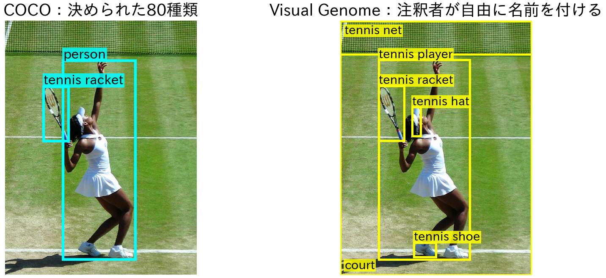
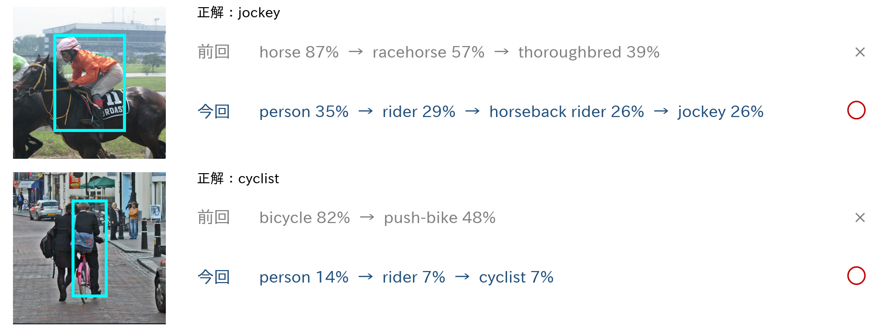
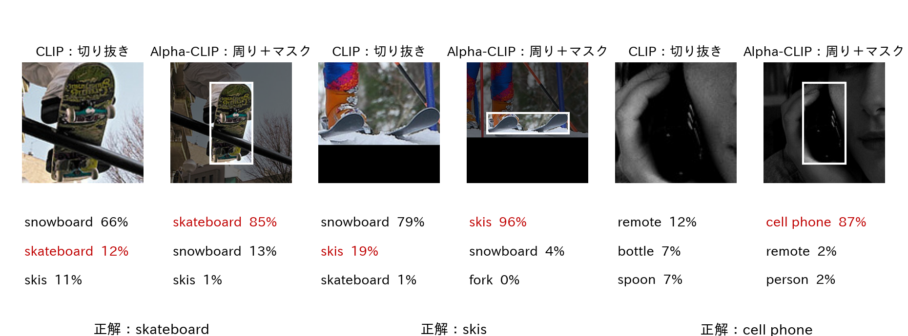

# report_050：slides_2026C に VG，決め方の違い，CLIP と Alpha-CLIP の差の説明を追加

## 1. 実施内容
ユーザーの3つの依頼に対し，`slides_2026C.pptx` に6枚を加えた（16枚 → 22枚）．新しい6枚すべてに発表者ノートを入れた．
- 新しい学習は行っていない．正解ボックスの保存済みの特徴量と，語彙の文章の特徴から再計算した．
- 論文は変更していない．

| 依頼 | 加えたスライド（枚） | 内容 |
| :--- | :--- | :--- |
| 1．VG とは | 7「VGとは：写真の物に自由に名前を付けたデータ」 | 同じ写真の COCO の注釈（person，tennis racket）と VG の注釈（tennis player，tennis hat，tennis shoe，court など）を並べた．VG の規模と，辞書を3263語に絞る目的を書いた |
| 2．決め方の違い | 9「前回と今回の決め方の違い：同じ物体で比べる」 | 果物売り（正解 seller）の実際の確率で比較した．前回は person（29%）の下の398語から gatherer（5%）を選んで誤り，今回は person の枝 76% → vendor の枝 69% で正解した |
| | 10「前回は最初の枝を間違えると戻れない」 | 騎手（前回 horse 87% → racehorse → thoroughbred ×，今回 person → rider → horseback rider → jockey ○）と，自転車に乗る人（前回 bicycle → push-bike ×，今回 person → rider → cyclist ○） |
| 3．CLIP と Alpha-CLIP | 18「Alpha-CLIPは周りの様子から，物の名前を見分ける」 | CLIP（切り抜き）と Alpha-CLIP（周り1.5倍＋マスク）の入力と上位3件の例を並べた．skateboard（CLIP は snowboard），skis（CLIP は snowboard），cell phone（CLIP は remote） |
| | 19「差が大きいのは人以外の物．人では悪くなる」 | 人と人以外に分けた正解率の表 |
| | 20「Alpha-CLIPが周りを見ながら注目できる理由」 | RGB とα（白＝主役）の入力の図．αを読む層を加え，マスク付きの写真と説明文の組で学習し直した仕組みを説明した |

依頼2の2枚では，名前を当てる係をどちらも Alpha-CLIP にそろえ，決め方だけを比べた．

### 図

## 2. 「圧倒的な差」について分かったこと
正解の箱で，COCO の80クラスの1位の予測が正しい割合を，人と人以外に分けて計算した（テスト用）．

| 名前を当てる係 | 人以外の物（2368件） | 人（1090件） | 全体（3458件） |
| :--- | ---: | ---: | ---: |
| CLIP ViT-B/32（切り抜き） | 50.8% | **47.2%** | 49.7% |
| Alpha-CLIP（切り抜き＋マスク） | 57.3% | 42.9% | 52.7% |
| Alpha-CLIP（周り1.5倍＋マスク） | **65.6%** | 24.5% | 52.7% |

- **人以外の物：** 周りを見る Alpha-CLIP が CLIP より約15ポイント高い．これが「圧倒的な差」である．特に，道具や乗り物など周りの様子で見分ける物に強い（skateboard と snowboard，cell phone と remote など）．
- **人：** 周りを見る Alpha-CLIP は大きく下がる．人の箱に，周りの持ち物の名前（frisbee，tv，surfboard，tennis racket など）を付けるためである．
- **全体：** 両者の効果が打ち消し合い，差は3ポイントにとどまる．同じ大きさの CLIP ViT-B/16 は全体で48.4%であり，差はモデルの大きさによるものではない．
- **今回のモデルの選択：** OWLv2 は人の箱を多く出すため，今回のモデルでは「切り抜き＋マスク」を使った．これはスライド19枚目に明記した．

## 3. その他の修正
- **言い方の修正：** 4枚目と6枚目の Alpha-CLIP の説明「周りも見ながら，注目する」を「見る場所をマスクで指定できる」に直した．今のモデルは「切り抜き＋マスク」を使っており，前の言い方は正確でなかったためである．発表者ノートも合わせて直した．
- **学科横断発表（第二回）の生成スクリプト：** `slides/build_slides_gakka2.py` は，このスライドの台本（`NOTES`）を番号で参照していた．6枚を加えて番号がずれたため，参照を直した．作り直した `学科横断発表(第二回).pptx` の内容は変わっていない．

## 4. 実装と確認
- **追加：**
  - `slides/explain_examples_2026C.py`：説明用の例を `slides/media_2026C/explain_examples.json` に保存する．
  - `slides/media_2026C/vg_32081.json`：VG の注釈のうち，使った写真1枚分．
  - `tests/test_slides_explain.py`（2件）
- **変更：** `slides/build_slides_2026C.py` に図の関数（`fig_vg_example`，`fig_crop`，`fig_naming_examples`，`fig_classifier_examples`，`fig_alpha_input`），6枚のスライド，6枚のノートを加えた．
- **テスト：** 関連するテストを合わせて10件実行し，全て通った．
- **目視の確認：** pptx-render で `slides_2026C.pdf`（22枚）を作成し，全てのスライドを確認した．
  - 最初の確認では，タイトルが長く2行になったものが4枚あった．ほかに，途中の改行，ラベルの重なり，画像と文字の重なりがあった．全て直した．
- **変更前のバックアップ：** `/tmp/claude-1000/-home-user-workspace-bong/097f1326-9149-47d6-84e7-54fbda3cf0a0/scratchpad/slides_2026C_before050.pptx`

## 5. 未解決の論点
- **学科横断発表（第二回）への反映：** 今回の6枚は加えていない．19枚目と28枚目の「周りも見ながら，注目する」もそのままである．
- **10枚目の例：** 前回の決め方で外れ，今回の決め方で正しかった例は36件ある．その中から分かりやすい例を選んでおり，典型的な結果ではない．
- **9枚目の vendor と seller：** vendor（VG の名前）は，WordNet で seller と同じ Synset（seller.n.01）である．
