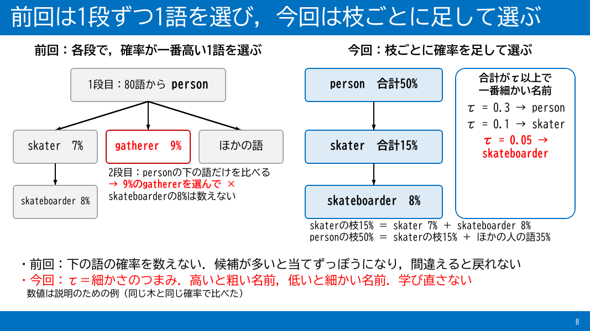

# report_051：slides_2026C の8枚目に，前の研究の下位語の探し方を追加

## 1. 実施内容
`slides_2026C.pptx` の8枚目（細かさの決め方）に，前の研究の決め方を加えた．同じ説明用の木と同じ確率を使い，左に前回，右に今回を並べた．枚数は22枚のまま変えていない．新しい実験は行っておらず，論文も変更していない．

| 項目 | 変更前 | 変更後 |
| :--- | :--- | :--- |
| タイトル | 枝ごとに確率を足し，τ以上で一番細かい名前を選ぶ | 前回は1段ずつ1語を選び，今回は枝ごとに足して選ぶ |
| 左半分 | 今回の木の図 | 前回の探し方：1段目で80語から person を選び，2段目で person のすぐ下の語だけを比べる |
| 右半分 | τ ごとの出力 | 今回の木の図（枝の合計）と τ ごとの出力 |

## 2. 前回の探し方の示し方
- 2段目の候補は skater（7%），gatherer（9%），ほかの語である．前回は各語の確率だけを比べるため，skater の下の skateboarder（8%）を数えず，gatherer を選んで誤る．
- 今回は，同じ確率でも skater の枝の合計が 15% になり，τ = 0.05 では skateboarder まで進む．
- 数値は説明のための例であり，その旨をスライドに書いた．gatherer は，9枚目の実例（果物売りに対して前回が gatherer を選んだ例）と同じ語にして，8枚目から9枚目へ話がつながるようにした．

## 3. 発表者ノート
- 8枚目のノートの前半に，前回の探し方の説明を加えた．
- 今回の決め方の説明は `TREE_NOTE` にまとめた．学科横断発表（第二回）の対応するスライドは今回の決め方だけを示しているため，ノートは `TREE_NOTE` だけを参照するように `slides/build_slides_gakka2.py` を直した．作り直した `学科横断発表(第二回).pptx` のノートの内容は変わっていない．

## 4. 確認
- 関連するテストを8件実行し，全て通った．
- pptx-render で `slides_2026C.pdf` を作成し，8枚目を目視で確認した．はみ出し，重なり，単語の途中の改行は無い．
- 変更前のバックアップ：`/tmp/claude-1000/-home-user-workspace-bong/097f1326-9149-47d6-84e7-54fbda3cf0a0/scratchpad/slides_2026C_before051.pptx`

## 5. 未解決の論点
- 8枚目と9枚目は，どちらも前回と今回の比較である．発表時間が足りない場合は，9枚目を省いてもよい．
- 前の回答で挙げた2点（総合点の具体例が無いこと，0.27→0.64のスライドのタイトルに「位置を正解にすると」が無いこと）は，まだ直していない．
- 学科横断発表（第二回）には，order_050 と今回の変更を反映していない．
