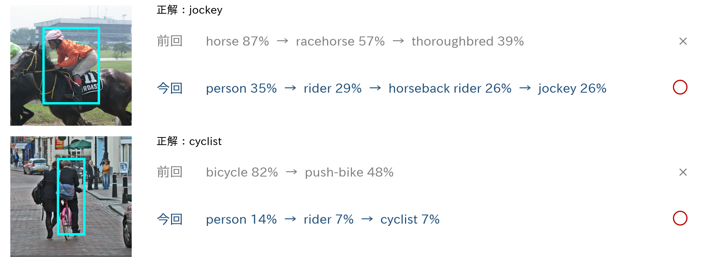
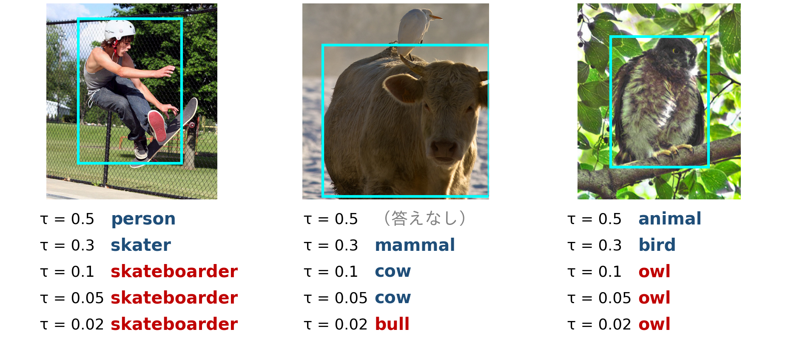
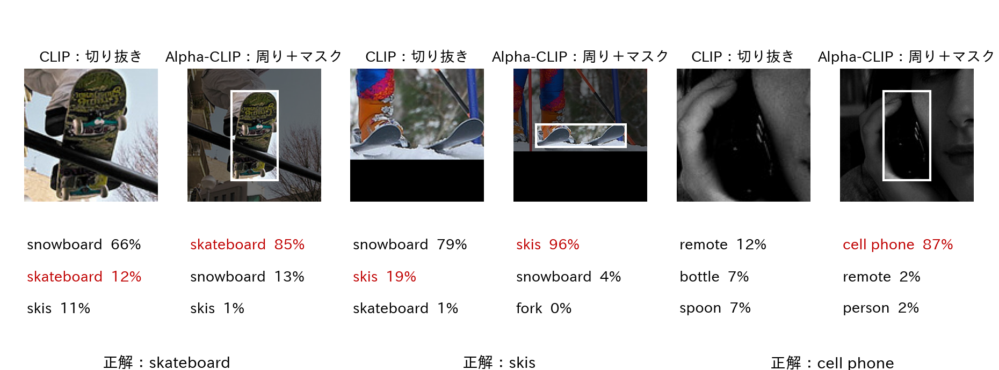

# report_052：発表のまとめ「学び直さずに，名前の細かさを変えられる物体アノテーション」

## 1. 目的
YOLO や DETR などの物体検出器は，学習した COCO の80種類の名前しか出力できない．人は全て person，鳥は全て bird になる．skateboarder や owl のような細かい名前を出すには，データを集めて学習し直す必要がある．本研究の目的は，**学習し直さずに，1つのつまみ τ で名前の細かさを変えられる**物体アノテーションのモデルを作ることである．自信が無いときは，間違った細かい名前ではなく，正しい粗い名前で止まることも目指す．

## 2. 前の研究と，その問題
前の研究は，DETR で物を見つけ，箱で切り抜いて CLIP に名前を付けさせ，WordNet の下位語を1段ずつ下って名前を細かくした．問題は次の3つであった．
1. DETR は80種類以外の物をほとんど見つけられない．
2. 切り抜くと，周りの様子が分からない．
3. WordNet の person の下には398語あり，各段で確率が一番高い1語を選ぶと，確率が散らばって当てずっぽうになる．一度間違えると戻れない．

## 3. 方法：4つの部品を取り替えた
どの部品も学習し直していない．

| 部品 | 前の研究 | 今回 | 理由 |
| :--- | :--- | :--- | :--- |
| 見つける係 | DETR | OWLv2 | 80種類以外の物も見つける |
| 名前を当てる係 | CLIP | Alpha-CLIP | 見る場所をマスクで指定できる |
| 辞書 | WordNet 全体 | WordNet∩VG（3263語） | 写真でよく使われる語だけに絞る（person の下は398語→136語） |
| 細かさの決め方 | 1段ずつ下る | 枝ごとに確率を足す | 確率が散らばらない |

辞書は，写真の物に自由に名前を付けたデータ Visual Genome（VG）で10回以上使われた語に絞った．

**細かさの決め方：** Alpha-CLIP が辞書の全ての語に確率を出す．各語について，その語と下にある全ての語の確率を足す（枝の合計）．枝の合計が τ 以上の語の中で一番細かい語を出力する．例えば skateboarder 8%，skater 自身 7% なら skater の枝は 15% になり，τ = 0.3 なら person，0.1 なら skater，0.05 なら skateboarder を出力する．前の研究の決め方は，その段の1語の確率だけを比べるため，skateboarder の8%を数えず，別の語を選んで誤ることがある．

## 4. 実験
- **写真：** COCO 2017 の500枚で τ を決め，別の500枚で評価した．τ = 0.05 とした．
- **細かい正解：** 写真の説明文（キャプション）の名詞のうち，物の種類（例：person）の下位語になる語を使った（912件，85%が人）．
- **80種類以外の物の正解：** LVIS の注釈（2687件）．
- **総合点（hF）：** 正解とその上位語の集合と，出力とその上位語の集合の重なりで測る点数．正解が skateboarder のとき，skateboarder は1.00，skater は0.92，person は0.60，car は0である．

## 5. 結果
### 5.1 前の研究との比較

| 指標（写真500枚） | 前の研究 | 今回 |
| :--- | ---: | ---: |
| 80種類以外の物を見つけた割合 | 12% | **73%** |
| 細かくて正しい名前の割合 | 6% | **11%** |
| 80種類の名前の点数（F値） | 0.38 | **0.41** |
| 総合点（hF） | 0.47 | 0.46 |

見つける力と細かい名前は良くなったが，見つけるところから全てを通した総合点はほぼ同じであった．

### 5.2 τ で細かさが変わる
τ を下げると，同じ物の名前が person → skater → skateboarder のように細かくなる．ただし，細かい答えが増えるほど間違いも増え，細かくて正しい答えは最大でも約15%であった．

### 5.3 枝ごとに足す効果
物の位置を正解で与え，名前の決め方だけを比べた．

| 名前の決め方（位置は正解） | 総合点（hF） | 正解率 |
| :--- | ---: | ---: |
| 80種類の名前だけ | 0.27 | 31% |
| 辞書を1段ずつ下る（前の研究） | 0.27 | 30% |
| 枝ごとに足す（今回） | **0.64** | **78%** |

5.1 で総合点がほぼ同じだったのは，見つける段階の誤り（余計な箱など）が全体の点数を下げているためである．

### 5.4 見つける係と名前を当てる係
- 80種類以外の物を見つけられたのは OWLv2 だけであった（OWLv2 73%，DETR 12%，YOLO11x 10%）．
- ただし80種類の名前だけの点数（F値）では，YOLO11x 0.54，DETR 0.49，OWLv2 0.41 であり，余計な箱の多い OWLv2 が低い．さらに，余計な箱を捨てる規則で，OWLv2 が見つけた80種類以外の物の多くも捨てられる（73% → 10%）．
- Alpha-CLIP は，どの見つける係と組み合わせても CLIP より F値が高かった．周りを見る Alpha-CLIP は，人以外の物で正解率が 51% から 66% に上がった（skateboard と snowboard の区別など）．一方で人では 25% に下がった．人の周りの物の名前を付けてしまうためである．そのため，今回のモデルでは周りを見すぎない「切り抜き＋マスク」を使った．

## 6. まとめと課題
学習し直さずに，つまみ τ だけで名前の細かさを変えられるモデルを作った．決め方を「1段ずつ」から「枝ごとに足す」に変えたことで，位置を正解にしたときの総合点は 0.27 から 0.64 に上がった．80種類以外の物を見つけられたのは OWLv2 だけであった．

課題は次の2つである．
1. 細かくて正しい名前は最大でも約15%と少ない．
2. 余計な箱を捨てる規則が，80種類以外の物も捨ててしまう．箱を残すかどうかの決め方（拒否のスコア）の改良が今後の課題である．

## 7. 補足と未解決の論点
- 細かい正解は写真単位のキャプションから作ったため，同じ写真の同じ種類の物には同じ正解が付く（見物人にも skateboarder が付くなど）．評価の85%が人であり，結果は人に偏っている．
- 5.2 と 3 章の図の例は，分かりやすい例を選んでおり，典型的な結果ではない．
