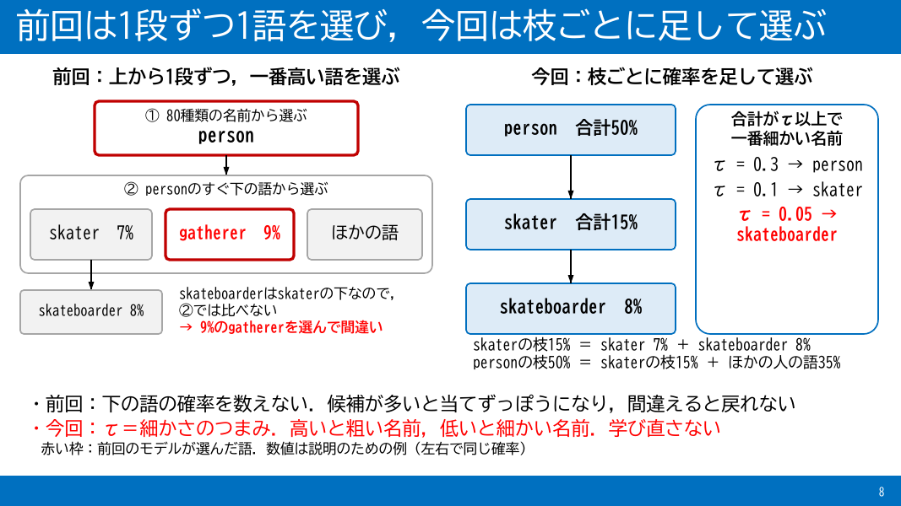

# report_053：slides_2026C の8枚目（前回の下位語の選び方）を分かりやすく修正

## 1. 指摘
8枚目の左半分（前回の選び方）について，「赤字はモデルが選んだ下位語か」「2段目の意味が分からない」との指摘を受けた．

## 2. 修正内容

| 項目 | 修正前 | 修正後 |
| :--- | :--- | :--- |
| 見出し | 前回：各段で，確率が一番高い1語を選ぶ | 前回：上から1段ずつ，一番高い語を選ぶ |
| 1回目の選択 | 「1段目　person」（灰色） | 「① 80種類の名前から選ぶ　person」（赤い枠） |
| 2回目の選択 | 「2段目：personの下の語だけを比べる」（候補の下の説明文） | 候補を1つの枠で囲み，枠の上に「② personのすぐ下の語から選ぶ」 |
| 赤い枠の意味 | 説明なし | スライド下の注に「赤い枠：前回のモデルが選んだ語」 |
| skateboarder | 「skateboarderの8%は数えない」 | 「skateboarderはskaterの下なので，②では比べない」 |

- 赤い枠は，前回のモデルが選んだ語（person と gatherer）である．
- ①②は，辞書の木を上から下りるときの1回目と2回目の選択である．選んだ語の下にさらに語があれば，同じ選択を繰り返す．
- 右半分（今回）と枚数（22枚）は変えていない．発表者ノートも①②と赤い枠の言い方に合わせて直した．

## 3. 確認
- 関連するテスト（`tests/test_slides_notes.py`，`tests/test_slides_gakka2.py`）は全て通った．
- pptx-render で `slides_2026C.pdf` を作成し，8枚目を目視で確認した．重なりや単語の途中の改行は無い．
- 変更前のバックアップ：`/tmp/claude-1000/-home-user-workspace-bong/097f1326-9149-47d6-84e7-54fbda3cf0a0/scratchpad/slides_2026C_before053.pptx`

## 4. 未解決の論点
- 9枚目（果物売りの実例）は，まだ「1段目」「2段目」の言い方である．8枚目に合わせて①②に直すとよい．
- 21枚目に「(b)(c) は箱の位置だけを使い，名前は Alpha-CLIP が付け直す」の注を加える提案は，まだ実施していない．
- 学科横断発表（第二回）に式のスライドを1枚加える提案も，まだ実施していない．
