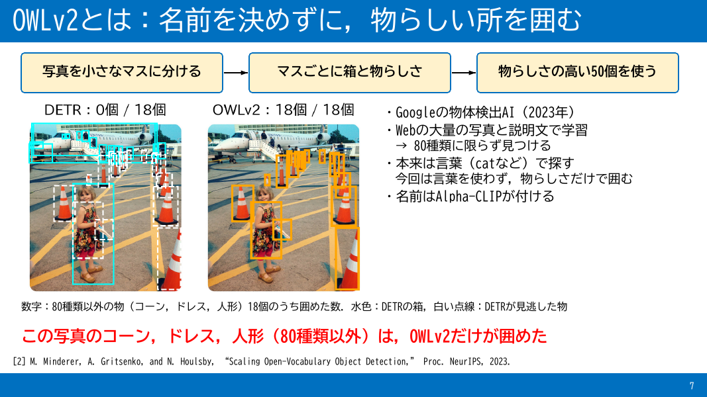

# report_054：slides_2026C に OWLv2 の紹介スライドを追加

## 1. 実施内容
`slides_2026C.pptx` の6枚目「提案モデル」の直後に，7枚目「OWLv2とは：名前を決めずに，物らしい所を囲む」を加えた（22枚 → 23枚）．新しい推論は行っていない．

| 部分 | 内容 |
| :--- | :--- |
| 上段（仕組み） | 写真を小さなマスに分ける → マスごとに箱と物らしさ → 物らしさの高い50個を使う |
| 左（実例） | 同じ写真での DETR（閾値0.5）と OWLv2（上位50個）の比較 |
| 右（説明） | Google の物体検出 AI（2023年）．Web の大量の写真と説明文で学習するため80種類に限らない．本来は言葉で探すが，今回は物らしさだけで囲む．名前は Alpha-CLIP が付ける |
| 結論（赤） | この写真のコーン，ドレス，人形（80種類以外）は，OWLv2 だけが囲めた |

## 2. 実例の選び方
`slides/owl_example_2026C.py` を新しく作った．test の写真のうち LVIS の注釈がある474枚について，LVIS の COCO 外の物体のうち「OWLv2 の上位50個の箱は囲めた（IoU 0.5 以上）が，DETR の箱は囲めなかった」物体を数え，`slides/media_2026C/owl_examples.json` に保存した．

候補の中から，物が見分けやすい写真 381639 を選んだ．
- COCO 外の物体：18個（コーン16個，ドレス，人形）
- DETR：箱19個（人と飛行機など）．COCO 外の物体は0個囲めた．
- OWLv2：上位50個の箱で18個全てを囲めた．

この写真は OWLv2 が特に良く見える例である．test 全体の COCO 外の物体の再現率は，OWLv2 が73%，DETR が12%である（15枚目の表）．

## 3. その他の変更
- **発表者ノート：** 7枚目のノートを加えた．OWLv2 は余計な箱も多く出すことにも触れ，後の弱点のスライドにつなげた．
- **学科横断発表（第二回）：** `slides/build_slides_gakka2.py` は slides_2026C のノートを番号で参照している．1枚加えたことで番号がずれたため，参照を1つずつ後ろにずらした．作り直した `学科横断発表(第二回).pptx` の内容は変わっていない．
- **テスト：** `tests/test_slides_notes.py` の想定枚数を23枚に変えた．関連するテスト8件は全て通った．

## 4. 確認
pptx-render で `slides_2026C.pdf`（23枚）を作成し，全てのスライドを目視で確認した．最初の確認では，図の見出しの重なり，写真が小さいこと，説明文の単語の途中の改行があったため，直した．

変更前のバックアップ：`/tmp/claude-1000/-home-user-workspace-bong/097f1326-9149-47d6-84e7-54fbda3cf0a0/scratchpad/slides_2026C_before054.pptx`

## 5. 未解決の論点
- 学科横断発表（第二回）には，OWLv2 の紹介スライドを加えていない．
- 実例の写真は，OWLv2 の良さが特に出る例を選んでいる．余計な箱（OWLv2 の箱の87%は物に当たらない）は図に示していない．
- 前の報告で挙げた，9枚目（現在は10枚目）の「1段目・2段目」の言い方の統一，22枚目（現在）の注の追加，学科横断発表（第二回）の式のスライドは，まだ実施していない．
