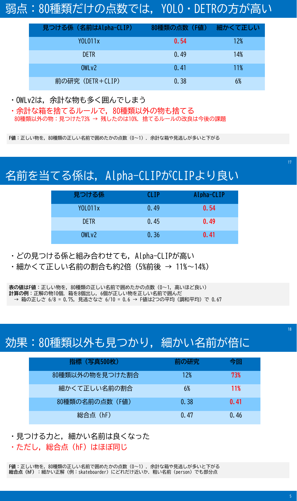

# report_055：slides_2026C に F値の説明を追加

## 1. 指摘
「名前を当てる係は，Alpha-CLIPがCLIPより良い」のスライドに，総合点（hF）の説明はあるが F値の説明が無いとの指摘を受けた．

## 2. 修正内容
F値を使う3枚の表の下に，灰色の枠で説明を加えた．枚数（23枚）は変えていない．

{height=17cm}

| スライド | 加えた説明 |
| :--- | :--- |
| 5枚目「効果」（F値が初めて出る） | F値：正しい物を，80種類の正しい名前で囲めたかの点数（0〜1）．余計な箱や見逃しが多いと下がる．あわせて総合点（hF）の説明も置いた |
| 17枚目「弱点」 | F値の同じ短い説明 |
| 18枚目「名前を当てる係」 | F値の意味と計算の例：正解の物10個，箱8個のうち6個が正しい → 箱の正しさ 6/8 = 0.75，見逃さなさ 6/10 = 0.6 → 調和平均で 0.67 |

- 「適合率」「再現率」の語は使わず，「箱の正しさ」「見逃さなさ」と言い換えた．
- 発表者ノート（5枚目と18枚目）にも同じ説明を加えた．
- `legend()` は，記号が空の行を前の行の続きとして表示するようにした．

## 3. 確認
- 関連するテスト8件は全て通った．
- pptx-render で `slides_2026C.pdf` を作成し，3枚を目視で確認した．重なりや単語の途中の改行は無い．
- 学科横断発表（第二回）は作り直したが，内容は変わっていない．
- 変更前のバックアップ：`/tmp/claude-1000/-home-user-workspace-bong/097f1326-9149-47d6-84e7-54fbda3cf0a0/scratchpad/slides_2026C_before055.pptx`

## 4. 未解決の論点
- 学科横断発表（第二回）の F値を使うスライドには，説明を加えていない．
- 説明の枠の文字は 15〜16pt と小さい．発表の会場で読みにくい場合は，口頭で補う．
- 7枚目（OWLv2）の「0個 / 18個」の見出しを分かりやすくする提案は，まだ実施していない．
