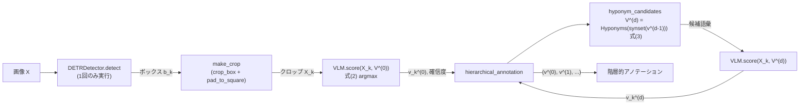
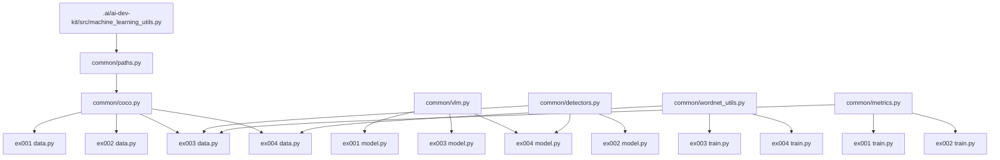

# document.md

本リポジトリは，論文「物体領域検出とカテゴリアノテーションの分離に基づく，WordNetを用いた粒度可変物体アノテーション」（`main.pdf`）の再現実装である．
提案手法は学習を伴わない推論パイプラインであり，カテゴリに依存しないDETRによるボックス検出，ボックスにちょうど合わせた局所クロップ，視覚言語モデル（Vision-Language Model，VLM）によるゼロショット分類，およびWordNetの下位語をたどる粒度可変アノテーションから構成される．

## 1. パイプラインと主要関数の関係



検出（DETR）は画像ごとに1回だけ実行され，候補語彙集合を変えて繰り返すのは `VLM.score` のみである．

## 2. ディレクトリとファイルの役割

| パス | 役割 |
| :--- | :--- |
| `main.pdf` | 再現対象の論文 |
| `programs/common/paths.py` | パス定義，`.ai/ai-dev-kit/src/machine_learning_utils.py`（`set_seed`，`ResultLogger`）の読み込み |
| `programs/common/coco.py` | COCO 2017 Validationの読み込み，seed=42での500枚のサンプリング，GT取得，クロップ（`crop_box`，`pad_to_square`，`make_crop`） |
| `programs/common/vlm.py` | VLM f の実装（`ResNet50IN1k`：閉域モデル，`CLIPModel`：open_clipのCLIP-RN50 / CLIP-ViT-B/32），`load_vlm` |
| `programs/common/detectors.py` | `DETRDetector`（提案手法），`OWLViTDetector`，`GroundingDINODetector`（比較対象，クラス間NMSでクラス非依存化） |
| `programs/common/wordnet_utils.py` | COCO 80クラスと追加22語のWordNet Synset対応表，`hyponym_candidates`（式(3)），`hierarchical_annotation` |
| `programs/common/metrics.py` | P@k / R@k，IoU，ハンガリアン法による1対1対応付け，ブートストラップ信頼区間，Wilcoxon符号付き順位検定 |
| `programs/ex001_coco_val500_image_word/` | 論文4.2節：ResNet50-IN1k / CLIP-RN50 / CLIP-ViT-B/32 による画像単位の単語推定（タスクA・B） |
| `programs/ex002_coco_4img_class_agnostic_det/` | 論文4.3節：DETR / OWL-ViT / Grounding DINO のクラス非依存の位置検出精度 |
| `programs/ex003_coco_val500_pipeline/` | 論文4.4節・4.5節：パイプライン全体のTop-1/Top-5正解率，WordNet深さごとの確信度 |
| `programs/ex005_coco_val500_yolo_comparison/` | order_003：閉域物体検出モデルYOLO（Ultralytics YOLO11n/m/x，YOLOv8x）とのCOCO 80クラスでの比較，YOLO-box + CLIP，4画像の位置検出精度，COCO外画像での定性比較 |
| `programs/ex004_open_vocab_qualitative/` | 論文4.6節・4.7節：COCO外の語を含む実画像（Wikimedia Commons）とCOCO画像の階層的アノテーションの定性結果 |
| `tests/` | `pytest` によるテスト（評価指標，WordNet処理） |
| `paper/` | 実験結果をまとめた和文論文（`main.tex`，章ごとの `sections/*.tex`，`figures/`，コンパイル済みの `main.pdf`） |
| `slides_object_annotation.pptx` / `.pdf` | 研究発表スライド（18枚，`.ai/ai-pptx-kit/templates/research.pptx` を元に作成）と，`.ai/pptx-render` でレンダリングしたPDF |
| `slides/build_slides.py` | スライドを生成するスクリプト（テンプレートを展開してOOXMLを直接書き込む．数式はpandocでLaTeXからOMMLへ変換） |
| `slides/media/` | スライド専用に作成した画像（YOLOと提案手法の検出結果の例） |
| `paper/make_figures.py` | `outputs/` の結果から論文用の図を作成し `paper/figures/` に保存する |
| `visualize_result.ipynb` | `outputs/` を走査して表・図を生成する |
| `.orders/`，`.reports/` | 作業指示と作業報告 |

各実験ディレクトリは `data.py`（データ作成），`model.py`（`load_model`），`train.py`（実行スクリプト）から成る．
本論文の手法は学習を行わないため，`train.py` は学習ではなく評価を実行し，`loss_func`・`epoch` 等の学習ループは持たない．
実験条件（シード，閾値，前処理等）は各 `train.py` の先頭で定義している．

## 3. プログラム間の依存関係



外部の学習済みモデルは以下を用いる（初回実行時に自動ダウンロードされる）．

| モデル | 取得元 |
| :--- | :--- |
| DETR (ResNet-50) | Hugging Face `facebook/detr-resnet-50`（revision `no_timm`） |
| OWL-ViT | Hugging Face `google/owlvit-base-patch32` |
| Grounding DINO | Hugging Face `IDEA-Research/grounding-dino-tiny` |
| CLIP-RN50，CLIP-ViT-B/32 | open_clip（`RN50` / `ViT-B-32`，pretrained=`openai`） |
| ResNet50-IN1k | torchvision `ResNet50_Weights.IMAGENET1K_V1` |
| YOLO11n/m/x，YOLOv8x | Ultralytics 8.3.170（重みは `datasets/ex005_coco_val500_yolo_comparison/weights/` に自動ダウンロード） |
| WordNet | NLTK `wordnet` コーパス |
| spaCy | `en_core_web_sm` 3.8.0 |

## 4. 環境構築

```bash
uv venv .venv_pytorch --python 3.11
uv pip install --python .venv_pytorch/bin/python -r requirements_pytorch.txt --index-strategy unsafe-best-match
.venv_pytorch/bin/python -c "import nltk; nltk.download('wordnet'); nltk.download('omw-1.4')"
.venv_pytorch/bin/python -m ipykernel install --user --name venv_pytorch --display-name "Python (.venv_pytorch)"
```

動作確認環境は，NVIDIA GeForce RTX 4070 Ti（12GB），Python 3.11，torch 2.7.1+cu128，transformers 4.53.2，open_clip 2.32.0 である．

データセットは `datasets/coco/` に配置する．

```bash
mkdir -p datasets/coco && cd datasets/coco
wget http://images.cocodataset.org/annotations/annotations_trainval2017.zip && unzip annotations_trainval2017.zip
wget http://images.cocodataset.org/zips/val2017.zip && unzip val2017.zip
```

ex004の画像は実行時にWikimedia Commonsから取得され，ライセンス情報とともに `datasets/ex004_open_vocab_qualitative/` に保存される．

## 5. 実行方法

```bash
cd programs/ex001_coco_val500_image_word && ../../.venv_pytorch/bin/python train.py      # 約1分
cd programs/ex002_coco_4img_class_agnostic_det && ../../.venv_pytorch/bin/python train.py # 約1分
cd programs/ex003_coco_val500_pipeline && ../../.venv_pytorch/bin/python train.py         # 約15分
cd programs/ex004_open_vocab_qualitative && ../../.venv_pytorch/bin/python train.py       # 約1分
cd programs/ex005_coco_val500_yolo_comparison && ../../.venv_pytorch/bin/python train.py  # 約2分（ex002〜ex004の結果を利用する）
.venv_pytorch/bin/jupyter nbconvert --to notebook --execute --inplace visualize_result.ipynb
.venv_pytorch/bin/python -m pytest tests
```

正常終了した条件（`metrics.json` 等が存在する条件）は再実行時にスキップされる．
中間データ（評価語彙，選定画像，DETRの検出結果のキャッシュ）は `datasets/ex{n:03}_*/` に保存される．
各実験は単一プロセスでピークVRAM 3GB未満，RAM 4GB未満，所要時間は数分程度であり，GPU推論が律速であるため並列数は1としている．

## 6. 実験結果の保存場所

`outputs/ex{n:03}_{共通条件}/{手法}/{条件}/{seed}/` に保存する．

| 実験 | 手法 | 条件 | 主なファイル |
| :--- | :--- | :--- | :--- |
| ex001 | VLM名 | タスク（`A` / `B`） | `metrics.json`（平均とブートストラップCI），`per_image.csv`，`config.json` |
| ex002 | 検出器名 | 閾値設定 | `metrics.json`，`per_gt.csv`，`detections.json` |
| ex003 | VLM名 | `detr_threshold{t}_crop_{center|pad}` | `metrics.json`，`instances.json`（各インスタンスの推定と階層），`depth_stats.csv` |
| ex005 | YOLOのモデル名，`yolo11x+CLIP-ViT-B32` | `{coco500, loc4, open_vocab}_conf{閾値}` | `metrics.json`，`instances.json`，`common_vs_{ex003の条件}.json`（共通GTでの比較とMcNemar検定） |
| ex004 | `CLIP-ViT-B32` | `{画像セット}_detr_threshold0.5_crop_pad` | `annotations.json`，画像ごとの図，`grid.png` |

`visualize_result.ipynb` が生成する表（`table_*.csv`）と図（`fig_*.png`）は各実験ディレクトリの直下に保存される．

## 7. 文書およびレポート

- `.orders/order_001.md`：再現実装の指示とその解釈
- `.reports/report_001.md`：実験条件，結果，論文値との比較，考察，未解決の論点
- `.orders/order_002.md`，`.reports/report_002.md`：論文の作成の指示と作業報告
- `paper/main.pdf`：実験結果をまとめた和文論文（order_003による追記箇所は赤字）
- `.orders/order_003.md`，`.reports/report_003.md`：YOLOとの比較実験と論文への追記の指示と作業報告
- `.orders/order_004.md`，`.reports/report_004.md`：発表スライドの作成の指示と作業報告

### 論文のビルド

```bash
.venv_pytorch/bin/python paper/make_figures.py   # outputs/ から図を再生成する
cd paper && latexmk -pdfdvi -synctex=1 main.tex  # platex + dvipdfmx（latexmkrc）でmain.pdfを生成する
```

### スライドのビルド

```bash
# pptx スキルの scripts（add_slide.py，clean.py）の場所を指定する
export PPTX_SKILL_SCRIPTS=<pptxスキルのディレクトリ>/scripts
.venv_pytorch/bin/python slides/build_slides.py
# スタイル確認用のPDF（LibreOfficeは使わない）
uv venv .ai/pptx-render/.venv_render --python 3.10
uv pip install --python .ai/pptx-render/.venv_render/bin/python -r .ai/pptx-render/requirements_render.txt
PYTHONPATH=.ai/pptx-render/programs .ai/pptx-render/.venv_render/bin/python -m pptx_renderer.cli slides_object_annotation.pptx -o slides_object_annotation.pdf
```

## 8. APIキー・設定ファイル

本実験のプログラムはAPIキーを必要としない．
`.ai/ai-agent/` のAIエージェントは `tokens.json` の `gemini` キーを必要とする（`tokens.json` は `.gitignore` に登録済み）．

## 9. Git管理上の注意

`datasets/`，`outputs/`，`.venv_*/` はGit管理の対象外である．
実験結果は `outputs/` に，再現に必要な条件は各 `train.py` と `config.json` に記録される．
