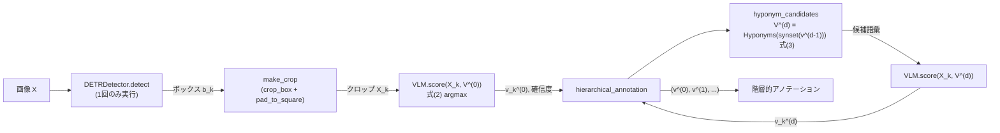

# document.md

本リポジトリは，論文「物体領域検出とカテゴリアノテーションの分離に基づく，WordNetを用いた粒度可変物体アノテーション」（`main.pdf`）の再現実装である．
提案手法は学習を伴わない推論パイプラインであり，カテゴリに依存しないDETRによるボックス検出，ボックスにちょうど合わせた局所クロップ，視覚言語モデル（Vision-Language Model，VLM）によるゼロショット分類，およびWordNetの下位語をたどる粒度可変アノテーションから構成される．

## 1. パイプラインと主要関数の関係



検出（DETR）は画像ごとに1回だけ実行され，候補語彙集合を変えて繰り返すのは `VLM.score` のみである．

## 2. ディレクトリとファイルの役割

| パス | 役割 |
| :--- | :--- |
| `main.pdf` | 再現対象の論文 |
| `programs/common/paths.py` | パス定義，`.ai/ai-dev-kit/src/machine_learning_utils.py`（`set_seed`，`ResultLogger`）の読み込み |
| `programs/common/coco.py` | COCO 2017 Validationの読み込み，seed=42での500枚のサンプリング，GT取得，クロップ（`crop_box`，`pad_to_square`，`make_crop`） |
| `programs/common/vlm.py` | VLM f の実装（`ResNet50IN1k`：閉域モデル，`CLIPModel`：open_clipのCLIP-RN50 / CLIP-ViT-B/32），`load_vlm` |
| `programs/common/detectors.py` | `DETRDetector`（提案手法），`OWLViTDetector`，`GroundingDINODetector`（比較対象，クラス間NMSでクラス非依存化） |
| `programs/common/wordnet_utils.py` | COCO 80クラスと追加22語のWordNet Synset対応表，`hyponym_candidates`（式(3)），`hierarchical_annotation` |
| `programs/common/metrics.py` | P@k / R@k，IoU，ハンガリアン法による1対1対応付け，ブートストラップ信頼区間，Wilcoxon符号付き順位検定 |
| `programs/ex001_coco_val500_image_word/` | 論文4.2節：ResNet50-IN1k / CLIP-RN50 / CLIP-ViT-B/32 による画像単位の単語推定（タスクA・B） |
| `programs/ex002_coco_4img_class_agnostic_det/` | 論文4.3節：DETR / OWL-ViT / Grounding DINO のクラス非依存の位置検出精度 |
| `programs/ex003_coco_val500_pipeline/` | 論文4.4節・4.5節：パイプライン全体のTop-1/Top-5正解率，WordNet深さごとの確信度 |
| `programs/ex005_coco_val500_yolo_comparison/` | order_003：閉域物体検出モデルYOLO（Ultralytics YOLO11n/m/x，YOLOv8x）とのCOCO 80クラスでの比較，YOLO-box + CLIP，4画像の位置検出精度，COCO外画像での定性比較 |
| `programs/ex006_coco_val500_yolo_clip_hybrid/` | order_006（論文4.9節）：深さ0をYOLO11x，深さ1以降をCLIP-ViT-B/32とWordNetで行うハイブリッド構成．COCO外の語への切替（`hybrid_switch`，`hybrid_switch_c0.5`）を含む．ex003〜ex005の結果を読み込む．order_008で `hybrid_switch_c{γ}` のCLIPのスコアの計算漏れを修正し，再実行した |
| `programs/ex007_coco_val_hierarchy_eval/` | order_008（論文4.10節，4.11節）：COCO val2017を検証用・テスト用に分割し，評価数を揃えた比較，深さ0の誤りの伝播，累積確信度による細分化の停止，LVIS v1による深さ1以降の評価（hP，hR，hF）を行う．ex005の YOLODetector を読み込む |
| `programs/ex008_coco_val_siglip_wordnet_root/` | order_009（比較文書 `paper_siglip_comparison/`）：VLMをSigLIP-ViT-B/16に変更し確信度をシグモイドで計算する構成，YOLOの検出スコアとVLMの最大確信度の比較による深さ0の決定（`hybrid_cmp`），WordNetにおいてCOCOのカテゴリと同じ深さにある語彙を深さ0の候補とする構成（`*_wn{k}`）を，ex007と同じ分割・指標とCOCO外の物体（LVIS）で評価する．ex007の data，model，train を読み込む |
| `programs/ex009_coco_siglip_wordnet_annotation/` | order_011（新しい論文 `paper_v2/` の4.2節，4.3節）：COCOでのYOLO11x単体，提案手法（DETR + SigLIP + WordNet），ハイブリッド手法（YOLO11x + SigLIP + WordNet）の比較と，LVISによる深さ1以降の評価（確信度はシグモイドとソフトマックス）．ex007の data（分割，検出のキャッシュ，LVIS）とex005の YOLODetector を読み込む |
| `programs/ex010_lvis_open_world_detection/` | order_011（`paper_v2/` の4.4〜4.6節）：COCO外の物体（LVIS）に対する4つの検出器（YOLO11x，DETR，OWLv2の物体らしさ，Grounding DINO）の再現率と，YOLO11xに候補を加えた構成の命名・粒度変更の評価．ex009，ex008の data と ex009の model を読み込む |
| `programs/ex011_open_world_naming/` | order_012（`paper_v2/` の3.7節，4.6節，赤字）：YOLO11xにOWLv2の候補を加える構成について，候補の棄却（物体らしさ，シグモイドの確信度，包含），頻出するカテゴリの語から順に下位語を選ぶ命名（キャプションで絞り込んだWordNetの木），語彙の限定，SigLIP SO400M，クロップの拡大，親の語を含むプロンプトを比較する．ex010の data・model を読み込む |
| `programs/ex012_wordnet_granular_annotation/` | order_013：`進捗報告_2026B.pdf` の「Alg. 粒度可変アノテーション」と評価方法の実装．物体認識モデル D（YOLO11x，DETR）のボックスに，埋め込みモデル F（CLIP，SigLIP）のコサイン類似度で単語を付け，θ 以上の間WordNetの下位語をたどる．定量評価（初期の語彙はCOCOの80クラス，下位語なし，Close Vocabularyモデルとの比較）と定性評価（初期の語彙はWordNetの上位語6語）．これまでの実験のモジュールや結果は用いない（`common/` の COCO の読み込みと IoU の対応付けのみを用いる） |
| `programs/ex013_open_vocabulary_granular/` | order_015：ex012のアルゴリズムに，検出の補完（YOLO11xのクラスを深さ0，OWLv2の物体らしさで領域を追加），WordNetの絞り込み，ソフトマックスによる停止，2段の先読み，SigLIP SO400Mを1つずつ加え，LVISの注釈でCOCO外の物体の検出・命名・細分化を評価する．ex012の data・model を読み込む |
| `programs/ex014_hierarchical_naming/` | order_018：COCO外の物体の命名の改善．上限の測定（LVISのカテゴリから1語を選ぶ場合の正解率），キャプションの語彙の確率をWordNetの上位語へ足し上げる命名，OWLv2の領域の特徴による命名，複数のテンプレートと定義文による文章の工夫を比較する．ex013の data・model・train を読み込む |
| `programs/ex015_lvis_open_vocabulary_annotation/` | order_019：再学習なしの粒度可変アノテーションのやり直し．OWLv2の領域の特徴から求めたキャプションの語彙（7806語）の確率をWordNetの上位語へ集約し，上位語から貪欲に下位語へ進む命名（`model.py` の `Hierarchy.choose`），語義を区別する文章，人の役割の除外，YOLO11xのボックスの細分化，加える領域の数と物体らしさによる棄却を順に検証用の画像で選ぶ（`train.py`）．OWLv2の重みは ST（`google/owlv2-base-patch16`，LVISの人手の注釈を用いない），FT（`-ensemble`，LVISで微調整），ST-L（`owlv2-large-patch14`）．`analysis.py` は K と棄却の閾値のトレードオフと ex014 の再現 |
| `programs/ex015a_annotation_score/` | order_020：アノテーションのスコア．ex015の data・model・train を読み込み（`data.ex015_modules`），全ての出力に経路上の各単語の集約した確率とスコアの特徴を付ける（`data.image_records`）．スコアは検出のスコア，命名の確率，両者の積，検証用の画像のみで重みを求めたロジスティック回帰（`model.LogisticCalibrator`）を比較し，スコアの順の対応付け（`model.match_greedy`），曲線とAP（`model.curve`，`model.average_precision`），校正誤差（`model.expected_calibration_error`）で評価する．経路上の各単語のスコアは `train.chain_scores` |
| `programs/ex015b_baselines_robustness/` | order_021：命名の方法の比較とばらつき・誤りの分解．ex015aの data・model・train を読み込み（`data.ex015a_modules`），加えた領域の命名を greedy（提案），flat（1語），LVISの語彙を与えた greedy_lvis，flat_lvis で求め直す（`data.method_records`）．ラベルの正誤による AP（`model.label_ap`），画像単位のブートストラップ（`model.bootstrap_difference`），誤りの分解（`model.error_breakdown`），GTと重なる領域のみを残す上限（`train.oracle_regions`），画像を分け直した5回の試行（`train.split_sets`）を行う |
| `programs/ex015c_divergence_analysis/` | order_026：COCO外の物体に対して，提案手法（greedy）の経路が正解の枝（GTの上位語・自身・下位語）から外れる段階の分析．ex015bの data を読み込み，COCO外のGTと対応した加えた領域を集め（`data.matched_noncoco`），外れた段階・正しい子と選んだ子の確率・順位（`model.divergence`），各段階の上位の下位語（`model.step_table`）を求める．ex004の実画像（kangaroo 等）にも適用する（`train.trace_open_images`） |
| `programs/ex016_wholeness_rejection/` | order_025：物体の全体らしさの特徴による，物体の一部・背景の加えた領域の棄却（提案A）．ex015bの data・model・train を読み込み（`data.ex015b_modules`），greedy と flat の記録に，幾何の特徴（他のボックスに含まれる割合，内側の領域の数，面積の比）とWordNetの特徴（含むボックスの語の part meronym に当たるか `data.is_meronym`，部分を表す語か `data.is_part_word`）を求め（`data.wholeness_features`），式(9)のロジスティック回帰に加える（`model.fit_scorers`，base・geom・wordnet・full，規則のみの rule）．評価・分け直し・ブートストラップは ex015b と同じ |
| `programs/ex017_coco_granular_annotation/` | order_027：`main.pdf` と `進捗報告_2026B.pdf` の内容を1つのフォルダにまとめた自己完結の実装（`programs/common/` や他の実験は読み込まない）．`data.py`（COCOの読み込み，seed 42 の dev/test 各500枚，正方形にパディングした切り抜き画像 `make_crop`，語彙 COCO 80・COCO外の22語・WordNetの上位語6語，キャプションの名詞・動詞，WordNetの直接の下位語 `hyponym_vocab`），`model.py`（D：DETR，YOLO11x，OWL-ViT，Grounding DINO．F：ResNet50-IN1k，CLIP-RN50，CLIP-ViT-B/32，SigLIP-ViT-B/16．進捗報告の Alg. `granular_annotation`（θ で停止，スコアは cosine と softmax）と全体の `annotate_image`），`train.py`（E1：Fの比較，E2：Dの比較，E3：定量評価とClose Vocabularyモデルの比較，E4：深さごとの確信度，E5：COCO外の画像，E6：定性評価） |
| `programs/ex018_owl_region_check/` | order_028：新しいパイプライン（OWL → SigLIP → WordNet）の前段として，OWLの領域検出がYOLO11xの検出領域を含み，YOLOが見逃す領域（特にCOCO外の物体）も検出できるかをLVISのGTで確認する．`data.py`（LVISの読み込みとCOCO/COCO外の判定，ex017のtestのうちLVISの注釈がある474枚，ex017の検出のキャッシュ），`model.py`（OWLv2のクエリのスコアと物体らしさのスコアによる検出 `OWLv2Detector`，重なりの判定 `covered`），`train.py`（予算を揃えた閾値 `budget_threshold`，GTの4分割の集計 `metrics_func`，閾値の掃引，比較画像） |
| `programs/ex019_coco_owl_alphaclip_wordnet/` | order_029：新しい提案手法（OWLv2 objectness → Alpha-CLIP-ViT-B/16 → WordNet）と古い提案手法（DETR → CLIP-ViT-B/32 → WordNet）の MSCOCO での比較．`data.py`（ex017 の data・model・train を `load_ex017` で読み込む，Alpha-CLIP の入力 `make_alpha_input`：crop，context1.5，context2，full），`model.py`（open_clip の CLIP ViT-B/16（QuickGELU）に `conv1_alpha` を加えて公式の重みを読み込む `AlphaCLIPEmbedder`，`OWLv2Objectness`，QuickGELU の CLIP `clip_embedder`），`train.py`（order_030 で D に YOLO11x と単体の評価 `evaluate_closed`（order_032 でハイブリッド手法の YOLO11x + F は外し，YOLO11x は単体と人物の再現率のみ），OWLv2 の予算の固定 `fixed_budget`，人物の再現率 `person_recall` を追加．E1：正解ボックスでの命名，E2：D × F × 棄却のスコアの評価と対応のあるブートストラップ，E3：速度，E4：深さごとの確信度と比較画像） |
| `programs/ex020_coco_owl_alphaclip_granularity/` | order_031・order_032：3手法（New：OWLv2@20 + Alpha-CLIP + WordNet，Old：DETR + CLIP-ViT-B/32 + WordNet，YOLO11x 単体）の粒度の変更（深さ1以降の細分化）までの MSCOCO での評価と，VG.pdf の語彙・枠・命名の手順の追加（VLM は SigLIP ではなく各手法の F）．`data.py`（ex017・ex019 を読み込む `load_module`，COCO のキャプションの細かい正解 `caption_nouns`・`fine_labels`，Visual Genome の頻度 `vg_counts`・語彙 `vg_vocab`，最上位の枠 `FRAMES`（40個）と枠＋WordNet の木 `build_tree`，VG.pdf の式(8)の集合 `eval_set`），`model.py`（WordNet の下位語の細分化 `full_chain`・`truncate`，VG の木の命名器 `TreeNamer`：木による細分化 `tree_chain`，平坦な命名 `flat`，部分木の確率の合計 `subtree_mass`），`train.py`（E0_coverage：語彙の被覆率，E1_gt：正解ボックス，E2_pipeline：3手法 × 手順（coarse，wn_hyponym，vg_tree，vg_flat，vg_subtree）を dev の hF で選ぶ `evaluate_procedure`，E3_step：WordNet の木と VG の木の各段の正解率，hF の対応のあるブートストラップ，図）．order_037 で E2_factorial（`train.py e2`，途中で中止），order_039 で E3_detector（`train.py e3`：検出器 OWLv2@20，OWLv2@50，YOLO11x，DETR × 分類器 CLIP-B32，Alpha-CLIP crop，context1.5 × 提案・従来の判定）と，その残したボックスの LVIS の照合（`train.py e3lvis`）を追加 |
| `programs/ex021_coco_owl_rejection/` | order_033：新しい提案手法（OWLv2 + Alpha-CLIP + WordNet）の深さ0の棄却の判定の探索．`data.py`（ex017・ex019・ex020 を読み込む `load_module`），`model.py`（棄却のスコア `rejection_score`：joint，objectness，vlm，mass（VG の木の COCO のクラスの部分木の確率の合計の最大値），mass_joint，重複・部分の除去 `dedup_mask`：none，nms，nms_contain），`train.py`（ボックスごとの量の前計算 `build_source`，OWLv2 のボックス数 × Alpha-CLIP の入力 × 除去 × スコア × 深さ0のラベル（coco，mass）の全ての組で dev の F値・hF で θ を選ぶ `evaluate_config`，古い提案手法と YOLO11x 単体を同じコードで評価，対応のあるブートストラップ，図） |
| `programs/summary_new_method/` | order_035：新しい提案手法の ex018〜ex021 の結果のまとめの図（`make_summary.py`．OWL と YOLO の比較 `plot_owl_yolo`，CLIP と Alpha-CLIP の比較 `plot_clip_alphaclip`），`show_alpha_inputs.py`（ex019 の `make_alpha_input` による Alpha-CLIP の入力 crop，context1.5，context2，full の実例の図）．新しい実験は行わず，outputs/ex018〜ex021 の CSV を読む |
| `programs/ex022_yolo_detr_region_check/` | order_038：YOLO11x（conf 0.25）と DETR（閾値0.5）の検出を COCO の test 500枚で比較（`train.py`）．ex017 で保存した検出結果を読み，正解を「両方」「YOLO だけ」「DETR だけ」「両方が見逃し」に分けて数え，ex018 と同じ形式の比較画像を作る．新しく検出器は動かさない |
| `slides/build_slides_2026B.py` | `paper_2026B` の発表スライド `slides_2026B.pptx` の作成（`build_slides.py` の部品を用いる）．スライド用の図は `slides/media_2026B/` |
| `slides/build_slides_2026C.py` | `paper_2026C` の発表スライド `slides_2026C.pptx`（order_041 で17枚，PDFは `slides_2026C.pdf`）の作成（`build_slides.py` の部品を用いる）．order_042 で `legend()` と記号の説明 `DEFS` を加え，表を含む7枚の表の下に記号の説明（灰色の枠）を置いた．order_050 で22枚にし，VG の説明，決め方の比較（実例），CLIP と Alpha-CLIP の比較と仕組みの6枚を加えた（`fig_vg_example()`，`fig_crop()`，`fig_naming_examples()`，`fig_classifier_examples()`，`fig_alpha_input()`）．order_051 で8枚目を「前回は1段ずつ1語を選び，今回は枝ごとに足して選ぶ」に変え，同じ説明用の木で前回の下位語の探し方（左）と今回の枝ごとの合計（右）を並べた．8枚目の今回の部分の台本は `TREE_NOTE` にまとめ，学科横断発表（第二回）でも使う．order_044 で16枚に組み替え，`fig_tau_examples()`（τ を変えた出力の例）と `fig_tau_tradeoff()`（τ ごとの出力の内訳）を加えた．スライド用の図は `slides/media_2026C/` と `paper_2026C/figures/fig_qualitative_slide.png` |
| `slides/tau_examples_2026C.py` | ex020 の正解ボックスの特徴（キャッシュ）から，τ ごとの部分木の確率の合計による出力を再計算し，τ を下げると細かい正解まで下る例を `slides/media_2026C/tau_examples.json` に保存する（order_044）．`outputs_by_tau()` → `is_refining()` → `main()`．テストは `tests/test_slides_tau_examples.py` |
| `slides/owl_example_2026C.py` | 保存済みの検出結果から，LVIS の COCO 外の物体のうち OWLv2（上位50個）だけが囲めた物体を写真ごとに数え，`slides/media_2026C/owl_examples.json` に保存する（order_054）．`owl_only()` |
| `slides/explain_examples_2026C.py` | 正解ボックスの保存済みの特徴から，前回（WordNet を1段ずつ）と今回（枝ごとの合計）の命名の経路，CLIP と Alpha-CLIP の COCO80 クラスの上位3件を求め，`slides/media_2026C/explain_examples.json` に保存する（order_050）．`subtree_path()`，`is_correct()`，`topk()`．テストは `tests/test_slides_explain.py` |
| `slides/build_slides_gakka2.py` | 前回の発表 `学科横断発表(第一回).pptx` を基準に，前半16枚（研究背景〜前回の結果）を使い，今回の研究の15枚（前回の課題〜まとめ）を python-pptx で加えて `学科横断発表(第二回).pptx`（31枚，PDF あり）を作る（order_048）．`KEEP_BEFORE` → `set_title_slide()`/`retitle()` → `add_new_slides()` → `reorder()`．数値は `build_slides_2026C` の集計関数から読む．テストは `tests/test_slides_gakka2.py` |
| `programs/ex022b_yolo_detr_equal_threshold/train.py` | YOLO11x と DETR の検出を，同じ閾値（0.5〜0.9），同じ箱の数（dev で DETR の閾値を合わせる），既定値の3通りで比較する（order_049）．ex017 の保存済みの検出結果を数え直すのみ．`load_data()` → `conditions()`（`match_threshold()`）→ `run()`（`evaluate()`）→ `plot()`．出力は `outputs/ex022b_yolo_detr_equal_threshold/` |
| `programs/ex004_open_vocab_qualitative/` | 論文4.6節・4.7節：COCO外の語を含む実画像（Wikimedia Commons）とCOCO画像の階層的アノテーションの定性結果 |
| `tests/` | `pytest` によるテスト（評価指標，WordNet処理，YOLOとの比較の集計，ハイブリッド構成の切替規則と集計，停止規則，SigLIPの正規化関数とWordNetの同じ深さの語彙，COCO外の物体の候補の追加と再現率，候補の棄却と上から下への命名の停止・評価，進捗報告2026Bのアルゴリズムと評価指標，WordNetの絞り込みと停止とLVISによる評価，確率の上位語への集約） |
| `paper_v2/` | order_011で研究をやり直して作成した新しい和文論文（`main.tex`，`sections/*.tex`，`figures/`，`make_figures.py`，`main.pdf`，8ページ．order_012の追記は赤字）．ルートの `main.pdf`（最初の8ページ版）と `paper/main.pdf` は残している |
| `paper_2026B/` | order_014：`進捗報告_2026B.pdf` の内容を実装したex012の結果をまとめた新しい和文論文（`main.tex`，`sections/*.tex`，`figures/`，`make_figures.py`，`main.pdf`，7ページ）．他の論文の文章は用いていない．order_016でex013の結果（3.3節，4.5節，5.3節など）を追記し，order_017で表1・表2を整理した（order_017の修正箇所は赤字） |
| `paper_2026C/` | order_034：新しい提案手法（OWLv2 + Alpha-CLIP + WordNet）の棄却の判定（ex021）を中心に，ex019〜ex021 の結果をまとめた和文論文．order_039 で検出器（OWLv2，YOLO11x，DETR）と分類器（Alpha-CLIP，CLIP）の比較を加えて作り直した．order_040 で棄却のスコアを今後の課題とし，モデル（検出器，分類器，語彙の木による粒度）を中心とする構成に組み替えた（修正箇所は赤字．ieicejsp，7ページ．`main.tex`，`sections/*.tex`，`figures/`，`make_figures.py`，`main.pdf`）．VG.pdf を前稿として引用する．`make_figures.py` の `fig_qualitative` は検出器を替えたモデルの出力を細かい語と深さ0の語の2つの粒度で描き，スライド用の `fig_qualitative_slide` も作る（テスト：`tests/test_paper_2026C_figures.py`） |
| `paper_siglip_comparison/` | ex008の3つの変更と現在の構成（CLIPとソフトマックス）を比較した和文の文書（`main.tex`，`sections/*.tex`，`figures/`，`main.pdf`）．主要な結果はorder_010で `paper/` の4.12節に追記した |
| `paper/` | 実験結果をまとめた和文論文（`main.tex`，章ごとの `sections/*.tex`，`figures/`，コンパイル済みの `main.pdf`） |
| `slides_object_annotation.pptx` / `.pdf` | 研究発表スライド（26枚，`.ai/ai-pptx-kit/templates/research.pptx` を元に作成．18〜22枚目がハイブリッド構成（ex006），23〜25枚目が評価の改善（ex007））と，`.ai/pptx-render` でレンダリングしたPDF |
| `slides/build_slides.py` | スライドを生成するスクリプト（テンプレートを展開してOOXMLを直接書き込む．数式はpandocでLaTeXからOMMLへ変換） |
| `slides/media/` | スライド専用に作成した画像（YOLOと提案手法の検出結果の例，ハイブリッド構成で深さ0の切替を誤った領域の切り出し）．ex006の `outputs/` と `datasets/coco/val2017/` を参照する |
| `paper/make_figures.py` | `outputs/` の結果から論文用の図を作成し `paper/figures/` に保存する |
| `visualize_result.ipynb` | `outputs/` を走査して表・図を生成する |
| `.orders/`，`.reports/` | 作業指示と作業報告 |

各実験ディレクトリは `data.py`（データ作成），`model.py`（`load_model`），`train.py`（実行スクリプト）から成る．
本論文の手法は学習を行わないため，`train.py` は学習ではなく評価を実行し，`loss_func`・`epoch` 等の学習ループは持たない．
実験条件（シード，閾値，前処理等）は各 `train.py` の先頭で定義している．

## 3. プログラム間の依存関係

```mermaid
flowchart TB
    utils[".ai/ai-dev-kit/src/machine_learning_utils.py"] --> paths["common/paths.py"]
    paths --> coco["common/coco.py"]
    coco --> e1d["ex001 data.py"] & e2d["ex002 data.py"] & e3d["ex003 data.py"] & e4d["ex004 data.py"]
    vlm["common/vlm.py"] --> e1m["ex001 model.py"] & e3m["ex003 model.py"] & e4m["ex004 model.py"]
    det["common/detectors.py"] --> e2m["ex002 model.py"] & e3d & e4m
    wnu["common/wordnet_utils.py"] --> e3t["ex003 train.py"] & e4t["ex004 train.py"] & e4d
    e5o["outputs/ex005 yolo11x instances.json"] & e3o["outputs/ex003 instances.json"] --> e6d["ex006 data.py"]
    e5m["ex005 model.py（YOLODetector）"] --> e6m["ex006 model.py"]
    e4d --> e6d
    wnu & vlm --> e6t["ex006 train.py"]
    met["common/metrics.py"] --> e1t["ex001 train.py"] & e2t["ex002 train.py"] & e3d
    coco & met --> e7d["ex007 data.py"]
    lvis["datasets/lvis/lvis_v1_val.json"] --> e7d
    e5m --> e7m["ex007 model.py"]
    det & vlm --> e7m
    e7d & e7m & wnu --> e7t["ex007 train.py"]
    e7d & e7m & e7t --> e8d["ex008 data.py"]
    wnu --> e8d
    e8d & vlm --> e8m["ex008 model.py（SigLIPModel）"]
    e8d & e8m --> e8t["ex008 train.py"]
    e6d --> e8t
    e7d --> e9d["ex009 data.py"]
    e5m & det & vlm --> e9m["ex009 model.py"]
    e9d & e9m --> e9t["ex009 train.py"]
    e9d & e8d --> e10d["ex010 data.py"]
    e9m & det --> e10m["ex010 model.py（OWLv2，Grounding DINO 等）"]
    e10d & e10m --> e10t["ex010 train.py"]
    e10d --> e11d["ex011 data.py（キャプションの語，語彙）"]
    e11d & vlm --> e11m["ex011 model.py（SO400M，上から下への命名）"]
    e11d & e11m & e10m --> e11t["ex011 train.py"]
    coco & met --> e12d["ex012 data.py"]
    e12d --> e12m["ex012 model.py（YOLO11x，DETR，CLIP，SigLIP，アルゴリズム）"]
    e12d & e12m --> e12t["ex012 train.py"]
    e12d --> e13d["ex013 data.py（LVIS，OWLv2のキャッシュ，キャプション）"]
    e13d --> e13m["ex013 model.py（OWLv2，SigLIP，絞り込み，先読み）"]
    e13d & e13m --> e13t["ex013 train.py"]
    e13d & e13m & e13t --> e14d["ex014 data.py（語彙，ex013の読み込み）"]
    e14d --> e14m["ex014 model.py（確率の集約，OWLv2の領域の特徴，文章の工夫）"]
    e14d & e14m --> e14t["ex014 train.py"]
    e13d & e13m & e13t --> e15d["ex015 data.py（LVIS，OWLv2の領域のキャッシュ，語彙）"]
    e15d --> e15m["ex015 model.py（OWLv2の領域の埋め込み，確率の集約と語の選択）"]
    e15d & e15m --> e15t["ex015 train.py"]
    e15t --> e15a["ex015 analysis.py（トレードオフ，ex014の再現）"]
    e15d & e15m & e15t --> e15ad["ex015a data.py（出力と経路の記録，スコアの特徴）"]
    e15ad --> e15am["ex015a model.py（スコア，校正，曲線とAP，ECE）"]
    e15ad & e15am --> e15at["ex015a train.py"]
    e15ad & e15am & e15at --> e15bd["ex015b data.py（命名の方法ごとの記録）"]
    e15bd --> e15bm["ex015b model.py（ラベルの AP，ブートストラップ，誤りの分解）"]
    e15bd & e15bm --> e15bt["ex015b train.py（分け直し，oracle）"]
    e15bd & e15bm & e15bt --> e16d["ex016 data.py（全体らしさの特徴，WordNetの部分関係）"]
    e16d --> e16m["ex016 model.py（特徴を加えたスコア，規則）"]
    e15bd --> e15cd["ex015c data.py（COCO外のGTと対応した領域）"]
    e15cd --> e15cm["ex015c model.py（外れた段階，各段階の確率）"]
    e15cd & e15cm --> e15ct["ex015c train.py（集計，実画像の経路）"]
    e16d & e16m --> e16t["ex016 train.py（分け直し，ブートストラップ，特徴の診断）"]
    coco2["datasets/coco（画像・注釈・キャプション）"] --> e17d["ex017 data.py（分割，切り抜き，語彙，WordNetの下位語）"]
    e17d --> e17m["ex017 model.py（D，F，granular_annotation，annotate_image）"]
    e17d & e17m --> e17t["ex017 train.py（E1〜E6）"]
    e17t -. "YOLO11x・OWL-ViTの検出のキャッシュ" .-> e18t["ex018 train.py（OWLとYOLOの領域の比較）"]
    lvis18["datasets/lvis（LVIS v1 val）"] --> e18d["ex018 data.py（LVIS，COCO/COCO外）"] --> e18t
    e18m["ex018 model.py（OWLv2Detector，covered）"] --> e18t
    e17t -. "data・model・train，DETRの検出のキャッシュ" .-> e19d["ex019 data.py（load_ex017，make_alpha_input）"]
    e19d --> e19m["ex019 model.py（AlphaCLIPEmbedder，OWLv2Objectness）"]
    e19d & e19m --> e19t["ex019 train.py（E1〜E4）"]
    e19t -. "検出・特徴のキャッシュ，E2 で選んだ θ0" .-> e20t["ex020 train.py（E0_coverage，E1_gt，E2_pipeline，E3_step）"]
    cap20["COCO captions_val2017"] --> e20d["ex020 data.py（caption_nouns，fine_labels，vg_vocab，FRAMES，build_tree，eval_set）"] --> e20t
    vg20["datasets/visual_genome（objects.json v1.2，image_data.json）"] --> e20d
    e20m["ex020 model.py（full_chain，truncate，TreeNamer）"] --> e20t
    e20t -. "fine_instances，instance_score，TreeNamer，VG の木" .-> e21t["ex021 train.py（E1_rejection）"]
    e21m["ex021 model.py（rejection_score，dedup_mask）"] --> e21t
```



外部の学習済みモデルは以下を用いる（初回実行時に自動ダウンロードされる）．

| モデル | 取得元 |
| :--- | :--- |
| DETR (ResNet-50) | Hugging Face `facebook/detr-resnet-50`（revision `no_timm`） |
| OWL-ViT | Hugging Face `google/owlvit-base-patch32` |
| Grounding DINO | Hugging Face `IDEA-Research/grounding-dino-tiny` |
| CLIP-RN50，CLIP-ViT-B/32 | open_clip（`RN50` / `ViT-B-32`，pretrained=`openai`） |
| SigLIP-ViT-B/16 | open_clip（`ViT-B-16-SigLIP`，pretrained=`webli`，ex008〜ex010．`common/vlm.py` の `SigLIPModel`） |
| OWLv2 | Hugging Face `google/owlv2-base-patch16-ensemble`（ex010，ex011，物体らしさのスコア） |
| SigLIP SO400M | open_clip（`ViT-SO400M-14-SigLIP-384`，pretrained=`webli`，ex011．画像エンコーダは半精度で計算） |
| ResNet50-IN1k | torchvision `ResNet50_Weights.IMAGENET1K_V1` |
| YOLO11n/m/x，YOLOv8x | Ultralytics 8.3.170（重みは `datasets/ex005_coco_val500_yolo_comparison/weights/` に自動ダウンロード） |
| WordNet | NLTK `wordnet` コーパス |
| LVIS v1 val | `https://dl.fbaipublicfiles.com/LVIS/lvis_v1_val.json.zip` を `datasets/lvis/` に展開する（ex007） |
| spaCy | `en_core_web_sm` 3.8.0 |

## 4. 環境構築

```bash
uv venv .venv_pytorch --python 3.11
uv pip install --python .venv_pytorch/bin/python -r requirements_pytorch.txt --index-strategy unsafe-best-match
.venv_pytorch/bin/python -c "import nltk; nltk.download('wordnet'); nltk.download('omw-1.4')"
.venv_pytorch/bin/python -m ipykernel install --user --name venv_pytorch --display-name "Python (.venv_pytorch)"
```

動作確認環境は，NVIDIA GeForce RTX 4070 Ti（12GB），Python 3.11，torch 2.7.1+cu128，transformers 4.53.2，open_clip 2.32.0 である．

データセットは `datasets/coco/` に配置する．

```bash
mkdir -p datasets/coco && cd datasets/coco
wget http://images.cocodataset.org/annotations/annotations_trainval2017.zip && unzip annotations_trainval2017.zip
wget http://images.cocodataset.org/zips/val2017.zip && unzip val2017.zip
```

ex004の画像は実行時にWikimedia Commonsから取得され，ライセンス情報とともに `datasets/ex004_open_vocab_qualitative/` に保存される．

## 5. 実行方法

```bash
cd programs/ex001_coco_val500_image_word && ../../.venv_pytorch/bin/python train.py      # 約1分
cd programs/ex002_coco_4img_class_agnostic_det && ../../.venv_pytorch/bin/python train.py # 約1分
cd programs/ex003_coco_val500_pipeline && ../../.venv_pytorch/bin/python train.py         # 約15分
cd programs/ex004_open_vocab_qualitative && ../../.venv_pytorch/bin/python train.py       # 約1分
cd programs/ex005_coco_val500_yolo_comparison && ../../.venv_pytorch/bin/python train.py  # 約2分（ex002〜ex004の結果を利用する）
cd programs/ex006_coco_val500_yolo_clip_hybrid && ../../.venv_pytorch/bin/python train.py # 約3分（ex003〜ex005の結果を利用する）
cd programs/ex007_coco_val_hierarchy_eval && ../../.venv_pytorch/bin/python train.py    # 約15分（5000枚の検出を含む．datasets/lvis/ が必要）
cd programs/ex008_coco_val_siglip_wordnet_root && ../../.venv_pytorch/bin/python train.py # 約20分（ex007の検出結果のキャッシュを利用する．SigLIPの重みは初回に自動ダウンロード）
cd paper_siglip_comparison && latexmk -pdfdvi -synctex=1 main.tex                          # ex008の比較文書
cd programs/ex009_coco_siglip_wordnet_annotation && ../../.venv_pytorch/bin/python train.py   # 約2分（ex007の検出結果のキャッシュを利用する）
cd programs/ex010_lvis_open_world_detection && ../../.venv_pytorch/bin/python train.py        # 検出のキャッシュ作成に約20分（OWLv2，Grounding DINOは初回に自動ダウンロード），評価に約20分
cd programs/ex011_open_world_naming && ../../.venv_pytorch/bin/python train.py               # 約2時間（lvis_devのOWLv2の推論約10分，SO400Mの特徴計算約1時間を含む）
.venv_pytorch/bin/python paper_v2/make_figures.py && cd paper_v2 && latexmk -pdfdvi -synctex=1 main.tex  # 新しい論文
cd programs/ex012_wordnet_granular_annotation && ../../.venv_pytorch/bin/python train.py    # 約30分（YOLO11xとDETRの5000枚の検出を含む）
.venv_pytorch/bin/python paper_2026B/make_figures.py && cd paper_2026B && latexmk -pdfdvi -synctex=1 main.tex  # ex012の論文
.venv_pytorch/bin/python paper_2026C/make_figures.py && cd paper_2026C && latexmk -pdfdvi -synctex=1 main.tex  # ex019〜ex021 の論文
cd programs/ex013_open_vocabulary_granular && ../../.venv_pytorch/bin/python train.py      # 約1.5時間（OWLv2の推論約20分，SO400Mの特徴計算約25分を含む）
cd programs/ex014_hierarchical_naming && ../../.venv_pytorch/bin/python train.py           # 約40分（ex013の結果を用いる．OWLv2の領域の特徴の計算約20分を含む）
cd programs && ../.venv_pytorch/bin/python ex015_lvis_open_vocabulary_annotation/train.py   # 約25分（領域のキャッシュがある場合．STとFTの領域のキャッシュ作成は各約30分）
cd programs && ../.venv_pytorch/bin/python ex015_lvis_open_vocabulary_annotation/analysis.py  # 約10分（ST-Lの領域のキャッシュ（約1.5時間）がある場合はST-Lも評価する）
cd programs && ../.venv_pytorch/bin/python ex015a_annotation_score/train.py                 # 約3分（ex015の領域のキャッシュを用いる）
cd programs && ../.venv_pytorch/bin/python ex015b_baselines_robustness/train.py          # 初回約32分（ブートストラップを含む）．結果がある条件は読み込んで飛ばす
cd programs && ../.venv_pytorch/bin/python ex015c_divergence_analysis/train.py           # 約6分（ex015の領域のキャッシュを用いる）
cd programs && ../.venv_pytorch/bin/python ex016_wholeness_rejection/train.py            # 初回約39分（ブートストラップを含む）．結果がある条件は読み込んで飛ばす
cd programs/ex017_coco_granular_annotation && ../../.venv_pytorch/bin/python train.py   # 初回約15分（検出と特徴のキャッシュがある場合は約3分）．main.pdf と進捗報告_2026B.pdf の統合実装
cd programs/ex018_owl_region_check && ../../.venv_pytorch/bin/python train.py   # 約3分（OWLv2の推論のキャッシュがある場合は約1分）．ex017の検出のキャッシュが必要
cd programs/ex019_coco_owl_alphaclip_wordnet && ../../.venv_pytorch/bin/python train.py   # 初回約40分（特徴と検出のキャッシュがある場合は約5分）．Alpha-CLIP の重み datasets/ex019_coco_owl_alphaclip_wordnet/weights/clip_b16_grit+mim_fultune_4xe.pth が必要（公式の Google Drive から取得）
cd programs/ex020_coco_owl_alphaclip_granularity && ../../.venv_pytorch/bin/python train.py   # 初回約10分（キャッシュがある場合は約5分）．ex019 の検出・特徴のキャッシュと E2 の summary.json，spaCy の en_core_web_sm，datasets/visual_genome/{objects.json, image_data.json}（Visual Genome v1.2．公開元の objects_v1_2.json.zip，image_data.json.zip）が必要
cd programs/ex021_coco_owl_rejection && ../../.venv_pytorch/bin/python train.py   # 初回約20分（Alpha-CLIP の crop の特徴の計算を含む．キャッシュがある場合は約2分）．ex019・ex020 の結果とキャッシュが必要
.venv_pytorch/bin/python programs/summary_new_method/make_summary.py  # ex018〜ex021 のまとめの図（数秒）．ex018〜ex021 の outputs が必要
cd programs/ex021_coco_owl_rejection && ../../.venv_pytorch/bin/python train.py e3 && ../../.venv_pytorch/bin/python train.py e3lvis  # order_039：検出器 × 分類器の比較（約15分．YOLO11x の特徴の計算を含む）と LVIS の照合
.venv_pytorch/bin/python programs/ex022_yolo_detr_region_check/train.py  # YOLO11x と DETR の検出の比較（約1分）．datasets/ex017_coco_granular_annotation/detections_{YOLO11x,DETR}_test.pt が必要
PPTX_SKILL_SCRIPTS=<pptxスキルのscripts> .venv_pytorch/bin/python slides/build_slides_2026B.py  # 発表スライド．PDFは .ai/pptx-render で作成する
PPTX_SKILL_SCRIPTS=<pptxスキルのscripts> .venv_pytorch/bin/python slides/build_slides_2026C.py  # paper_2026C の発表スライド．PDFは .ai/pptx-render で作成する
.venv_pytorch/bin/jupyter nbconvert --to notebook --execute --inplace --ExecutePreprocessor.kernel_name=python3 visualize_result.ipynb  # venv_pytorch カーネルは別プロジェクトのPythonを指しているため python3 を指定する
.venv_pytorch/bin/python -m pytest tests
```

正常終了した条件（`metrics.json` 等が存在する条件）は再実行時にスキップされる．
中間データ（評価語彙，選定画像，DETRの検出結果のキャッシュ）は `datasets/ex{n:03}_*/` に保存される．
各実験は単一プロセスでピークVRAM 3GB未満，RAM 4GB未満，所要時間は数分程度であり，GPU推論が律速であるため並列数は1としている．

## 6. 実験結果の保存場所

`outputs/ex{n:03}_{共通条件}/{手法}/{条件}/{seed}/` に保存する．

| 実験 | 手法 | 条件 | 主なファイル |
| :--- | :--- | :--- | :--- |
| ex001 | VLM名 | タスク（`A` / `B`） | `metrics.json`（平均とブートストラップCI），`per_image.csv`，`config.json` |
| ex002 | 検出器名 | 閾値設定 | `metrics.json`，`per_gt.csv`，`detections.json` |
| ex003 | VLM名 | `detr_threshold{t}_crop_{center|pad}` | `metrics.json`，`instances.json`（各インスタンスの推定と階層），`depth_stats.csv` |
| ex005 | YOLOのモデル名，`yolo11x+CLIP-ViT-B32` | `{coco500, loc4, open_vocab}_conf{閾値}` | `metrics.json`，`instances.json`，`common_vs_{ex003の条件}.json`（共通GTでの比較とMcNemar検定） |
| ex006 | `hybrid`，`hybrid_switch`，`hybrid_switch_c0.5` | `coco500_conf{閾値}`，`{open_vocab, coco_qualitative}_conf0.25` | `metrics.json`（深さ0の正解率，正命名率，階層の対象数，切替数），`instances.json`，`depth_stats.csv`，`chain_agreement_vs_{ex003の条件}.json`，`annotations.json`，`grid.png` |
| ex007 | `proposed`，`hybrid`，`hybrid_switch`，`hybrid_switch_c0.5` | `{dev500, test500, lvis_dev, lvis_test}_th{閾値}` | `metrics.json`（誤りの伝播，AUROC，LVISの深さ1の正解率），`instances.json`（全インスタンスの深さ0と下位語の展開），`stopping_curve.csv`（τと深さの上限ごとの指標）．直下に `splits_seed42.json`，`table_conditions.csv`，`table_pairs_agreement.csv`，`table_stopping.csv` |
| ex008 | `{CLIP-ViT-B32_softmax, SigLIP-ViT-B16_softmax, SigLIP-ViT-B16_sigmoid}/{proposed, proposed_wn{k}, hybrid, hybrid_switch_c0.5, hybrid_cmp, hybrid_cmp_wn{k}}` | `{dev500, test500, lvis_dev, lvis_test, lvis_dev_noncoco, lvis_test_noncoco, open_vocab}_th{閾値}` | `metrics.json`（ex007の指標と切替の改善・悪化の数，COCO外の物体の深さ0の正解率），`instances.json`，`stopping_curve.csv`，`annotations.json`，`grid.png`．直下に `table_conditions.csv`，`table_noncoco.csv`，`table_stopping.csv`，`table_vocab.csv`，`table_depth1_auroc.csv` と可視化の `table_summary.csv`，`fig_*.png`．深さ0の語彙は `datasets/ex008_coco_val_siglip_wordnet_root/wordnet_root_vocab_k{k}_min1.json` |
| ex009 | `{yolo, proposed, hybrid}/{none, sigmoid, softmax}` | `{dev500, test500, lvis_dev, lvis_test}_th{閾値}` | `metrics.json`（Top-1，r，N_h，AUROC，LVISの深さ1の正解率とhP/hR/hF），`instances.json`，`stopping_curve.csv`．直下に `table_conditions.csv`，`table_stopping.csv`，可視化の `table_summary.csv`，`fig_lvis_stopping.png` |
| ex010 | `{yolo, hybrid, proposed, hybrid+{yolo_low, detr_low, owlv2, gdino}}/{none, wn, lvis}` | `lvis_test_K{加える候補の数}` | `metrics.json`（COCO外の物体の検出・命名・到達の割合，COCOの物体の命名率），`records.json`．直下に `table_recall.csv`，`table_end2end.csv`，`qualitative/`（`annotations.json`，`grid_*.png`），可視化の `fig_recall.png`，`fig_end2end.png`．検出のキャッシュは `datasets/ex010_lvis_open_world_detection/` |
| ex011 | `{ex010_baseline, p2_reject, p1_flat_stop, p1_topdown, p3_flat_wncap, p4_*, p34_*, hybrid_only}` | `{lvis_dev, lvis_test}` | lvis_dev：`grid.csv`（全ての閾値の組の指標），`metrics.json`．lvis_test：`metrics_{B1, B2, B5, hF}.json`（予算ごとに選んだ閾値の結果），`records_B2.json`，`config.json`．直下に `table_results.csv`，可視化の `table_B2.csv`，`fig_budget.png`．キャプションの語・木・lvis_devのOWLv2の推論結果は `datasets/ex011_open_world_naming/` |
| ex012 | `closed_{yolo, detr}`，`proposed_{yolo, detr}_{CLIP, SigLIP}`（θ を選んだもの），`..._no_reject`（θ = −1），`qualitative_{D}_{F}` | `{dev, test}` | `metrics.json`（ラベルの一致率，適合率・再現率・F値，mAP，ボックスのずれ），`predictions.json`（test），`config.json`，`theta_curve.csv`（dev），定性評価の `annotations.json`，`grid.png`．直下に `table_quantitative.csv`，可視化の `table_test.csv`，`fig_theta.png`．検出のキャッシュは `datasets/ex012_wordnet_granular_annotation/` |
| ex013 | `{ex012, A_root, A_add, B_prune, BD_stop, BDC_look, BDE_strong, BDCE_all}` | `{dev, test}` | `metrics.json`（COCO外・COCOの物体の検出・命名・細分化，hP/hR/hF，加えた領域の正解率），`config.json`，`tau_curve.csv`（dev）．直下に `table_results.csv`，`qualitative/`，可視化の `table_summary.csv`，`fig_configs.png` |
| ex014 | `{C_look, P1_flat, P1_agg, P2_agg_owl, P3_agg_ens, P23_agg_owl_ens}` | `{dev, test}` | `metrics.json`（ex013の指標と，加えた領域がCOCO外の物体に重なった場合の命名率と深さ），`config.json`，`tau_curve.csv`（dev）．直下に `upper_bound.json`，`table_results.csv`，`qualitative/`，可視化の `table_summary.csv`，`fig_methods.png` |
| ex015 | `S1_{flat, deepest, backoff, greedy}`，`S2_{plain, gloss, ens}_{all, noperson}`，`S3_yolo_refine`，`S4_{final, k10, k20, k50, k100}`，`S5_{ens, st_large}` | `{dev, test}` | `metrics.json`（COCO外・COCOの物体の検出・命名・細分化，hP/hR/hF，fed_hF，strict_hF，加えた領域の適合率），`config.json`．直下に `diagnosis.json`（S0），`grid_S{1-4}_st.csv`（dev），`selected_settings.json`，`table_results.csv`，`tradeoff_{st, ens, st_large}.csv`，`operating_points.csv`，`ex014_reproduction.json`，`fig_tradeoff.png`，`qualitative/`．領域のキャッシュは `datasets/ex015_lvis_open_vocabulary_annotation/regions_{st, ens, st_large}_{dev, test}_n*.pt` |
| ex015a | `{det, name, det_x_name, det_x_name_added, calibrated}/{st, st_large, ens}` | `42` | `metrics.json`（dev，test のAP_fed，AP_strict，ECE，閾値を選んだ場合の指標），`config.json`，`curve_{dev, test}.csv`，`reliability.json`．直下に `table_results.csv`，`calibrator_*.json`，`word_calibrator_*.json`，`chain_reliability_*.json`，`qualitative/`（スコア付きの出力），可視化の `table_summary.csv`，`fig_score_st.png` |
| ex015b | `{greedy, flat, greedy_lvis, flat_lvis, greedy_oracle, flat_oracle}_{det, calibrated}/{st, st_large, ens}` | `42`（元の分割），`0`〜`4`（分け直し） | `metrics.json`（dev，test のAP_fed，AP_strict，AP_exact，AP_named，ECE，閾値での指標），`config.json`（校正の重み），`errors.json`（誤りの分解），`curve_test.csv`（seed 42のみ）．直下に `table_results.csv`，`table_seeds.csv`，`bootstrap_{st, ens}.json`，`paired_naming_*.json`，可視化の `summary_seeds.csv`，`summary_errors.csv`，`fig_methods.png`，ログ `run.log`，`run_oracle.log` |
| ex015c | `{st, ens}` | `42` | `regions.csv`（領域ごとの経路，外れた段階，確率，順位，枝の語数），`summary.json`（割合，分岐元，組の頻度），`config.json`，`fig_examples.png`（深さ0で外れた例），`open_images_trace.json`，`fig_open_images.png`（ex004の実画像）．直下に可視化の `fig_divergence.png`，`summary_models.csv`，ログ `run.log` |
| ex016 | `{greedy, flat}_{base, geom, wordnet, full, rule}/{st, st_large, ens}` | `42`（元の分割），`0`〜`4`（分け直し） | `metrics.json`（ex015bと同じ指標），`config.json`（特徴名と校正の重み），`errors.json`（誤りの分解），`curve_test.csv`（seed 42のみ）．直下に `table_results.csv`，`table_seeds.csv`，`bootstrap_{st, ens}.json`，`diagnosis_{st, st_large, ens}.json`（誤りの種類ごとの特徴の平均，部分と判定した領域の内訳），可視化の `summary_seeds.csv`，`fig_scores.png`，ログ `run.log` |
| ex017 | `E1_vlm/{ResNet50-IN1k, CLIP-RN50, CLIP-ViT-B32, SigLIP-ViT-B16}`，`E2_detector/{DETR, YOLO11x, OWL-ViT, Grounding_DINO}`，`E3_quantitative/{closed_{D}, proposed_{D}_{F}_{cosine, softmax}_{all, theta}}`，`E4_depth/DETR_{F}_{mode}`，`E5_open_vocab/DETR_{F}_{mode}`，`E6_qualitative/DETR_{F}_{mode}` | E1 `{taskA, taskB}`，E2 `{test500, test4}`，E3 `{dev, test}`，E4 `test`，E5 `coco80_extra`，E6 `{coco80, wordnet_tops}`（seedは `0`） | `metrics.json`，`config.json`，E1 `per_image.csv`，E3 `theta_curve.csv`（dev）・`predictions.json`（test），E4 `depth_table.csv`・`chains.json`，E5・E6 `annotations.json`・`grid.png`．直下に `E1_vlm/wilcoxon.csv`，`E3_quantitative/thetas_and_timing.csv`，可視化の `table_E{1-4}_*.csv`，`fig_E{1,3,4}_*.png`，ログ `train.log`．キャッシュ（検出，切り抜き画像の特徴，分割，キャプションの語，YOLOの重み，COCO外の画像）は `datasets/ex017_coco_granular_annotation/` |
| ex018 | `{OWL-ViT_query, OWLv2_query, OWLv2_objectness}` | `{budget10, budget20, budget50, thr0.1}`（1枚あたりの平均ボックス数を揃えた閾値と固定の閾値．seedは `0`） | `metrics.json`（GTの4分割，条件付きの検出率，95%信頼区間），`config.json`．直下に `curve.csv`（閾値の掃引），`fig_examples_gain.png`・`fig_examples_loss.png`（比較画像），`fig_summary.png`・`table_ex018.csv`（可視化），`train.log`．OWLv2の検出のキャッシュは `datasets/ex018_owl_region_check/` |
| ex019 | `E1_naming/{CLIP-ViT-B32, CLIP-ViT-B32-GELU, CLIP-ViT-B16, AlphaCLIP-ViT-B16_{crop,context1.5,context2,full}}`，`E2_pipeline/{DETR,OWLv2}+{F}+{vlm,joint}`（order_032 で `YOLO11x+{F}` を削除），`OWLv2+{F}+{vlm,joint}@{20,50}`，`YOLO11x-closed`，`E3_speed/{手法}`，`E4_depth/{手法}` | E1 `{dev,test}`，E2 `{all,theta}_{dev,test}`，E3・E4 `test100`（seedは `0`） | `metrics.json`，`config.json`，E1 `correct_top1.npy`・`summary.csv`・`mcnemar_test.csv`，E2 `counts.npy`・`summary.json`・`selection.csv`・`theta_curve.csv`，直下の `summary_test.csv`・`paired_bootstrap_test.csv`，E3 `annotations.json`，E4 `depth_table.csv`・`fig_comparison.png`，`owl_budget_thresholds.json`，`fig_summary.png`，`train.log`．キャッシュ（OWLv2 の検出，特徴，Alpha-CLIP の重み）は `datasets/ex019_coco_owl_alphaclip_wordnet/` |
| ex020 | `E1_gt/{CLIP-ViT-B32, AlphaCLIP-ViT-B16_context1.5}+{coarse, wn_hyponym, vg_tree, vg_flat, vg_subtree}`，`E2_pipeline/{New, Old}+{同じ手順}`，`E2_pipeline/YOLO11x+coarse` | `selected_{dev,test}`（dev の hF で選んだ条件．seedは `0`） | `metrics.json`，`config.json`，`counts.npy`，`instances.csv`，手法の直下の `grid_{dev,test}.csv`・`summary.json`，`E0_coverage/coverage_test.csv`，`E3_step/{steps,summary}_test.csv`，直下の `summary_test.csv`・`paired_bootstrap_hf_test.csv`・`stats.json`・`fig_granularity_tradeoff.png`・`fig_granularity_examples.png`・`fig_summary.png`・`train.log`．キャッシュ（キャプションの名詞，VG の頻度と木，WordNet の出力の列）は `datasets/ex020_coco_owl_alphaclip_granularity/` |
| ex021 | `E1_rejection/New_OWLv2@{20,50}_{context1.5,crop}_{none,nms,nms_contain}_{joint,objectness,vlm,mass,mass_joint}[_masslabel]`，`Old_DETR_CLIP-B32_none_vlm[_masslabel]`，`YOLO11x_closed` | `{f1,hf}_{dev,test}`（θ を dev の F値，hF で選んだ条件．seedは `0`） | `metrics.json`，`config.json`，`counts_{coco,sub,coarse}.npy`，手法の直下の `theta_curve_dev.csv`・`summary.json`，`E1_rejection/summary_test.csv`・`paired_bootstrap_test.csv`，`fig_rejection_factors.png`，`fig_rejection_examples.png`，`fig_summary.png`，`train.log`．キャッシュ（ボックスごとの量）は `datasets/ex021_coco_owl_rejection/`，Alpha-CLIP の crop の特徴は `datasets/ex019_coco_owl_alphaclip_wordnet/` |
| ex021（E3） | `E3_detector/{OWLv2@20,OWLv2@50,YOLO11x,DETR}_{CLIP-B32,Alpha-crop,Alpha-context1.5}_{proposed,previous}` | `{f1,hf}_{dev,test}` | `E3_detector/summary_test.csv`（θ は dev の F値），`paired_bootstrap_test.csv`，`lvis_test.csv`（残したボックスと棄却前の全てのボックスの COCO 外の物体の再現率，COCO の正解に当たらないボックスの内訳．LVIS の注釈がある test の474枚），`train_order039.log` |
| summary_new_method | — | — | `fig_owl_yolo.png`（ex018 の被覆，ex019 の人物・人物以外の再現率，ex021 の F値・hF・人物の再現率），`fig_clip_alphaclip.png`（ex019 の深さ0の Top-1，ex020 の正解ボックスの hF と細分化の各段の正解率），`table_summary.csv`，`fig_alpha_inputs.png`（Alpha-CLIP の入力の実例） |
| ex022_yolo_detr_region_check | — | — | `table_gt_status.csv`（正解の内訳．人物・人物以外・全体），`table_detector.csv`（ボックス数，再現率，正解に当たらないボックスの割合），`fig_gt_status.png`，`fig_examples_detr_gain.png`，`fig_examples_yolo_gain.png`（比較画像），`table_detector_all.csv`（order_039：OWLv2@20，@50 を加えた4つの検出器．ex021 の E3_detector の閾値が必要） |
| ex004 | `CLIP-ViT-B32` | `{画像セット}_detr_threshold0.5_crop_pad` | `annotations.json`，画像ごとの図，`grid.png` |

`visualize_result.ipynb` が生成する表（`table_*.csv`）と図（`fig_*.png`）は各実験ディレクトリの直下に保存される．

## 7. 文書およびレポート

- `.orders/order_001.md`：再現実装の指示とその解釈
- `.reports/report_001.md`：実験条件，結果，論文値との比較，考察，未解決の論点
- `.orders/order_002.md`，`.reports/report_002.md`：論文の作成の指示と作業報告
- `paper/main.pdf`：実験結果をまとめた和文論文（16ページ．order_010による追記箇所（4.12節など，ex008の結果）は赤字．order_008以前の追記箇所は黒字に戻した）
- `.orders/order_003.md`，`.reports/report_003.md`：YOLOとの比較実験と論文への追記の指示と作業報告
- `.orders/order_004.md`，`.reports/report_004.md`：発表スライドの作成の指示と作業報告
- `paper/qa_summary.md`，`paper/qa_summary.pdf`：論文の手法と実験結果に関する質疑応答（16件）の整理
- `.orders/order_005.md`，`.reports/report_005.md`：質疑応答の整理の指示と作業報告
- `.orders/order_006.md`，`.reports/report_006.md`：YOLOとCLIPのハイブリッド構成の実装と論文への追記（4.9節，追記箇所は赤字）の指示と作業報告
- `.orders/order_007.md`，`.reports/report_007.md`：ハイブリッド構成（ex006）の発表スライドへの追加の指示と作業報告
- `.orders/order_008.md`，`.reports/report_008.md`：評価の改善（ex007，論文4.10節・4.11節，スライド23〜25枚目）とex006の不具合修正の指示と作業報告
- `.orders/order_009.md`，`.reports/report_009.md`：SigLIPとシグモイド，YOLOとVLMのスコアの比較，WordNetの同じ深さの語彙（ex008）の指示と作業報告
- `paper_siglip_comparison/main.pdf`：ex008の3つの変更と現在の構成を比較した文書（6ページ）
- `.orders/order_010.md`，`.reports/report_010.md`：ex008の結果の論文（4.12節）への追記の指示と作業報告
- `.orders/order_011.md`，`.reports/report_011.md`：研究のやり直し（ex009，ex010）と新しい論文 `paper_v2/main.pdf` の作成の指示と作業報告
- `paper_v2/main.pdf`：新しい論文（8ページ）．order_012の追記（3.7節，4.6節，要旨・はじめに・考察・おわりに）は赤字．`main.pdf`（ルート）と `paper/main.pdf` は旧版として残している
- `.orders/order_012.md`，`.reports/report_012.md`：COCO外の物体の命名の改善（ex011）の指示と作業報告
- `.orders/order_013.md`，`.reports/report_013.md`：`進捗報告_2026B.pdf` の内容の実装（ex012）の指示と作業報告
- `.orders/order_014.md`，`.reports/report_014.md`：ex012の結果の論文 `paper_2026B/main.pdf` の作成の指示と作業報告
- `.orders/order_015.md`，`.reports/report_015.md`：COCO外の語彙の物体の検出と粒度可変アノテーションの改善（ex013）の指示と作業報告
- `.orders/order_016.md`，`.reports/report_016.md`：ex013の結果の `paper_2026B` への追記（赤字）の指示と作業報告
- `.orders/order_017.md`，`.reports/report_017.md`：`paper_2026B` の表1・表2の整理の指示と作業報告
- `.orders/order_018.md`，`.reports/report_018.md`：COCO外の物体の命名の改善（ex014）の指示と作業報告
- `.orders/order_019.md`，`.reports/report_019.md`：再学習なしの粒度可変アノテーションのやり直し（ex015），`paper_2026B` の書き直し（今回の修正箇所は赤字，order_017の赤字は黒字に戻した），発表スライド `slides_2026B.pptx`（PDFは `slides_2026B.pdf`）の作成の指示と作業報告
- `.orders/order_020.md`，`.reports/report_020.md`：アノテーションのスコアの付与と改善（ex015a），`paper_2026B`（4.6節等を赤字で追記，order_019の赤字は黒字に戻した）と `slides_2026B.pptx` への反映の指示と作業報告
- `.orders/order_021.md`，`.reports/report_021.md`：論文の課題（比較手法，標準に近い指標，ばらつき，誤りの分解，構成）の改善（ex015b），`paper_2026B` の再構成（題目・要旨・はじめに・考察・おわりにを書き直し，4.5節・4.7節を追加，order_020の赤字は黒字に戻した）と `slides_2026B.pptx` の更新の指示と作業報告
- `.orders/order_022.md`，`.reports/report_022.md`：論文とスライドの評価を主張に必要なもの（検出・命名・細分化，AP_strict，AP_exact，ECE，同じ領域での命名の比較，誤りの分解，ブートストラップ）に絞る整理．新しい実験は無く，表の値は元の分割（seed 42）のテスト用の値．LVISとOWLv2を使う理由と「学習時に無い」の定義を論文に明記した
- `.orders/order_023.md`，`.reports/report_023.md`：論文とスライドの出力例の図に，経路上の各単語の確信度（式(10)のスコア r）とアノテーションのスコア s を表示する修正．`paper_2026B/make_figures.py` の `fig_qualitative_open`，`fig_qualitative`（予備実験は各単語のコサイン類似度），`slides/build_slides_2026B.py` の `example_items`，`fig_example_single`，`chain_runs`．この変更は order_024 で取り消した
- `.orders/order_024.md`，`.reports/report_024.md`：order_023 の変更を取り消し，`paper_2026B` と `slides_2026B.pptx` を order_022 の完了時点の状態に戻した
- `.orders/order_025.md`，`.reports/report_025.md`：提案A（ボックスの位置関係とWordNetの部分と全体の関係による物体の一部・背景の領域の棄却，ex016）の実装と評価．AP_strict の向上は0.003以下で効果は小さかった．`paper_2026B` に表6と4.7節の段落を追加（赤字，order_022の赤字は黒字に戻した），`slides_2026B.pptx` に19枚目を追加
- `.orders/order_026.md`，`.reports/report_026.md`：COCO外の物体で，提案手法の経路が深さ0などで正解の枝から外れ，誤った枝の中で細かい語へ進む事例の分析（ex015c）．論文・スライドは変更していない
- `.orders/order_027.md`，`.reports/report_027.md`：`main.pdf` と `進捗報告_2026B.pdf` の内容を新しいフォルダ `programs/ex017_coco_granular_annotation/` に自己完結の形で実装し，論文4章と進捗報告の評価（E1〜E6）を再実行した．論文・スライドは変更していない
- `.orders/order_028.md`，`.reports/report_028.md`：提案手法とハイブリッド手法を廃してOWL → SigLIP → WordNetのパイプラインに変更する前段として，OWLの領域検出をYOLO11xと比較した（ex018）．既存手法の削除と新しいパイプラインでの再実験は未実施
- `.orders/order_029.md`，`.reports/report_029.md`：新しい提案手法（OWLv2 + Alpha-CLIP + WordNet）と古い提案手法（DETR + CLIP + WordNet）を MSCOCO で比較した（ex019）．既存の手法のプログラム・結果は削除していない
- `.orders/order_030.md`，`.reports/report_030.md`：ex019 に YOLO11x（単体および検出器として）と，OWLv2 の予算を20個/枚・50個/枚に固定した条件（手法名の末尾 `@20`，`@50`）を追加して再実験した．人物・人物以外の再現率 `E2_pipeline/recall_person_test.csv`，比較画像 `E4_depth/fig_comparison_order030.png`
- `.orders/order_031.md`，`.reports/report_031.md`：VG.pdf の評価の考え方（階層的評価，正解ボックス，粒度と正しさの交換）を参考に，提案手法の粒度の変更（深さ1以降の細分化）までを MSCOCO で評価した（ex020）．細かい正解は COCO のキャプションから作った（order_032 で ex020 を改訂したため，report_031 の図と数値は現在の outputs と一致しない）
- `.orders/order_032.md`，`.reports/report_032.md`：ハイブリッド手法（YOLO11x + F）を ex019・ex020 の比較から外し（結果フォルダと特徴のキャッシュは削除．ex006〜ex011 は残す），比較を3手法にした．VG.pdf の語彙（Visual Genome の頻度），枠＋WordNet の木，木による細分化・平坦な命名・部分木の確率の合計を ex020 に追加し，評価を VG.pdf の式(8)に合わせた
- `.orders/order_033.md`，`.reports/report_033.md`：新しい提案手法の深さ0の棄却の判定（ボックス数，Alpha-CLIP の入力，重複・部分の除去，棄却のスコア，深さ0のラベル）を探索した（ex021）．dev の F値で選んだ最良の条件（OWLv2@50，crop，nms_contain，mass_joint，mass ラベル）が古い提案手法の F値を上回った
- `.orders/order_034.md`，`.reports/report_034.md`：ex019〜ex021 の結果をまとめた論文 `paper_2026C/main.pdf`（6ページ）と発表スライド `slides_2026C.pptx`・`slides_2026C.pdf`（15枚）の作成
- `.orders/order_035.md`，`.reports/report_035.md`：新しい提案手法（ex018〜ex021）のこれまでの結果のまとめ．特に OWL と YOLO の比較，CLIP と Alpha-CLIP の比較
- `.orders/order_036.md`，`.reports/report_036.md`：スライド `slides_2026C` の「従来の判定」を改良前・改良後の表記に変更し，4枚目（課題）の表に改良後の New を追加
- `.orders/order_038.md`，`.reports/report_038.md`：YOLO11x と DETR の検出の比較（ex022）．ex018 の fig_examples_gain.png と同じ形式の比較画像を作成
- `.orders/order_039.md`，`.reports/report_039.md`：提案手法の検出器（OWLv2，YOLO11x，DETR）と分類器（Alpha-CLIP，CLIP）の比較（ex021 の E3_detector）を行い，論文 `paper_2026C`（8ページ）とスライド `slides_2026C`（18枚）を作り直した
- `.orders/order_040.md`，`.reports/report_040.md`：棄却のスコアの話を今後の課題とし，論文 `paper_2026C`（7ページ）とスライド `slides_2026C`（14枚）をモデル中心の構成に組み替えた（新しい実験なし）
- `.orders/order_041.md`，`.reports/report_041.md`：スライド `slides_2026C` に前稿のモデル（DETR＋CLIP）の紹介と，現在のモデルへの更新点と理由の3枚を加えた（17枚）
- `.orders/order_042.md`，`.reports/report_042.md`：スライド `slides_2026C` の表を含む全ての7枚（4，5，8，9，11，13，14枚目）に，表の記号（hF，Fine，R_N など）の簡単な説明を加えた
- `.orders/order_043.md`，`.reports/report_043.md`：「VGの語彙の木」の表記を「WordNet∩VGの木」（語はVGに現れるWordNetのSynset，親子はWordNetの上下関係）に統一した．論文は order_040 の赤字を黒に戻し，今回の修正のみ赤字にした（7ページ）．`make_figures.py` の `fig_step` の凡例も変更
- `.orders/order_044.md`，`.reports/report_044.md`：研究結果を簡単に伝えるため，スライドを16枚に組み替えた（τ を変えた例とトレードオフの2枚を追加，検出器の比較を2枚に縮小，限界を結果のスライドに明記）
- `.orders/order_045.md`：スライドを発表者として紹介する台本をチャットで示した（ファイルの変更なし）
- `.orders/order_046.md`，`.reports/report_046.md`：台本に合わせ，スライド16枚の文と表を簡単にした（専門用語の言い換え，表を2〜3列に縮小，7枚目は式を木の例の図に置き換え，図のラベルを日本語化）
- `.orders/order_047.md`，`.reports/report_047.md`：発表の台本を各スライドの発表者ノートに入れた（`build_slides_2026C.py` の `NOTES` と `add_notes()`．テストは `tests/test_slides_notes.py`）
- `.orders/order_048.md`，`.reports/report_048.md`：前回の学科横断発表のスライドを基準に，前回と今回の研究を結合した `学科横断発表(第二回).pptx`（31枚）を作成した
- `.orders/order_049.md`，`.reports/report_049.md`：YOLO11x と DETR の検出を同じ閾値・同じ箱の数で比較し直した（ex022b）
- `.orders/order_050.md`，`.reports/report_050.md`：`slides_2026C` に VG の説明，前回と今回の決め方の違い（実例2枚），CLIP と Alpha-CLIP の差（例，人と人以外の表，仕組み）の6枚を加えた（22枚）
- `.orders/order_051.md`，`.reports/report_051.md`：`slides_2026C` の8枚目に前の研究の下位語の探し方（1段ずつ，各段で確率が一番高い1語）を加え，今回の枝ごとの合計と左右に並べた
- `.orders/order_052.md`，`.reports/report_052.md`：`slides_2026C` の発表内容（目的，方法，実験，結果，課題）を発表を聞いていない人向けに4ページにまとめた（新しい実験なし）
- `.orders/order_053.md`，`.reports/report_053.md`：`slides_2026C` の8枚目の前回の選び方を①②の言い方と赤い枠（モデルが選んだ語）で分かりやすくした
- `.orders/order_054.md`，`.reports/report_054.md`：`slides_2026C` に OWLv2 の紹介スライド（7枚目）を加えた（23枚）．例は `slides/owl_example_2026C.py`（DETR が見逃し OWLv2 が囲めた COCO 外の物体を数え，`slides/media_2026C/owl_examples.json` に保存）で選んだ
- `.orders/order_055.md`，`.reports/report_055.md`：`slides_2026C` の F値を使う3枚（5，17，18枚目）に F値の説明（18枚目は計算の例つき）を加えた

### 質疑応答の整理のビルド

```bash
# $`...`$ の数式表記をpandocの $...$ に置換してからLuaLaTeX（ltjsarticle）でPDF化する
cd paper && ../.venv_pytorch/bin/python -c "
import re, pypandoc
src = re.sub(r'\\$\`(.+?)\`\\$', r'\$\1\$', open('qa_summary.md', encoding='utf-8').read())
pypandoc.convert_text(src, 'pdf', format='markdown', outputfile='qa_summary.pdf', extra_args=['--pdf-engine=lualatex', '-V', 'documentclass=ltjsarticle', '-V', 'geometry:margin=18mm', '-V', 'fontsize=10pt'])
"
```

### 論文のビルド

```bash
.venv_pytorch/bin/python paper/make_figures.py   # outputs/ から図を再生成する
cd paper && latexmk -pdfdvi -synctex=1 main.tex  # platex + dvipdfmx（latexmkrc）でmain.pdfを生成する
```

### スライドのビルド

```bash
# pptx スキルの scripts（add_slide.py，clean.py）の場所を指定する
export PPTX_SKILL_SCRIPTS=<pptxスキルのディレクトリ>/scripts
.venv_pytorch/bin/python slides/build_slides.py
# スタイル確認用のPDF（LibreOfficeは使わない）
uv venv .ai/pptx-render/.venv_render --python 3.10
uv pip install --python .ai/pptx-render/.venv_render/bin/python -r .ai/pptx-render/requirements_render.txt
PYTHONPATH=.ai/pptx-render/programs .ai/pptx-render/.venv_render/bin/python -m pptx_renderer.cli slides_object_annotation.pptx -o slides_object_annotation.pdf
```

## 8. APIキー・設定ファイル

本実験のプログラムはAPIキーを必要としない．
`.ai/ai-agent/` のAIエージェントは `tokens.json` の `gemini` キーを必要とする（`tokens.json` は `.gitignore` に登録済み）．

## 9. Git管理上の注意

`datasets/`，`outputs/`，`.venv_*/` はGit管理の対象外である．
実験結果は `outputs/` に，再現に必要な条件は各 `train.py` と `config.json` に記録される．
